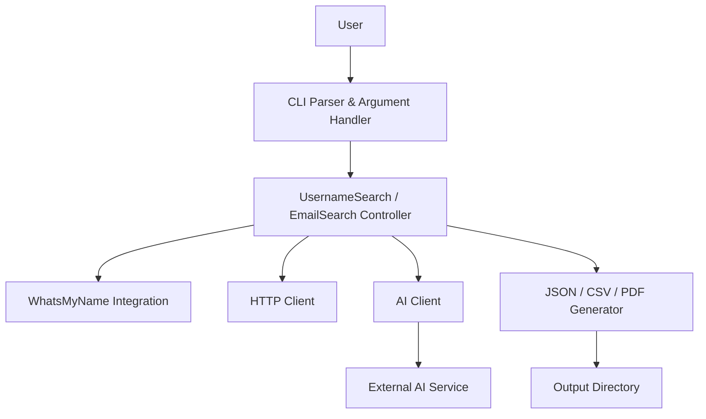

# p1ngul1n0/blackbird

> OSINT command-line tool: searches a username or e-mail across more than 600 sites.

## The problem
Checking by hand where an identifier is present across hundreds of platforms is slow and prone to false positives.

## What it actually does
- Takes a username (`--username`) or an e-mail address (`--email`) and queries the community WhatsMyName list (600+ sites).
- Filters and analyzes the responses, then exports to JSON, CSV or PDF.
- `--ai` option: sends to an external AI service only the names of the sites found, to get a behavioral and technical profile. Key to be generated via `--setup-ai`, daily quota.
- No database: results go to disk.

## How it is wired


## Trying it
```bash
git clone https://github.com/p1ngul1n0/blackbird
cd blackbird
pip install -r requirements.txt
python blackbird.py --username johndoe
python blackbird.py --email johndoe@example.com
python blackbird.py --setup-ai
python blackbird.py --username johndoe --ai
```

## Cost and gotchas
Free; the AI feature requires a key (`--setup-ai`) and applies a daily limit. Requests go out to hundreds of third-party sites.

## What it is not
It is not legally neutral: it targets identifiable people. The README declares it for educational use and asks not to use it without authorization; GDPR and local law apply. No license declared: reuse rights are undefined. Last push in July 2025.

## Alternatives
- WhatsMyName: the site list Blackbird relies on, usable on its own.

## For you
Watch: useful for defensive OSINT or auditing the exposure of your own accounts, but the lack of a license and the barely active repo hold back any integration into a pipeline.
