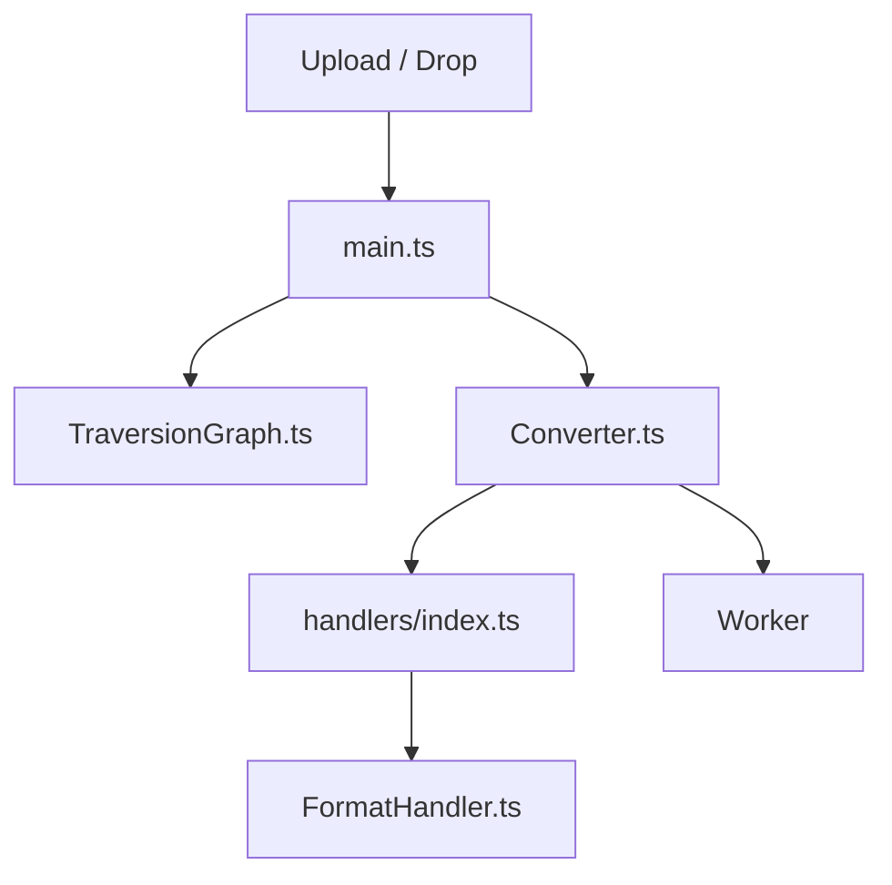

# p2r3/convert

> Online file converter that chains tools to go from one format to almost any other.

## The problem
Online converters only handle a single type of media and require uploading your files to a server.

## What it actually does
The user drops a file, the input format is detected, and they choose the output format. The program searches for a chain of converters ("handlers") in a format graph and runs it step by step, sometimes in a web worker, then offers the download. Each tool is wrapped in a normalized handler in `src/handlers`.

## How it is wired


## Trying it
```bash
git clone https://github.com/p2r3/convert
bun install
bun run dev
docker compose -f docker/docker-compose.yml up -d
```

## Cost and gotchas
Free. The first display is slow (format list to generate), `bun run cache:build` speeds it up. The Docker build installs Chromium. Issues that merely request a format are rejected. The README requires declaring AI use in contributions.

## What it is not
Not a guarantee of fidelity: converting between distant formats yields "what it can", not necessarily what is expected. Not uploading files is the README's argument, not an audit.

## Alternatives
No alternative named in the README.

## For you
Worth watching: handy for one-off conversions without sending your files anywhere, but no role in a data or AI pipeline.
