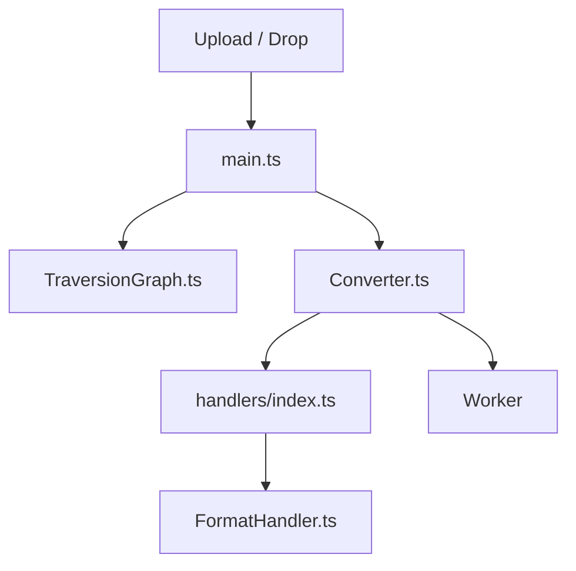

# p2r3/convert

> Convertisseur de fichiers en ligne qui enchaîne des outils pour passer d'un format à presque n'importe quel autre.

## Le problème
Les convertisseurs en ligne ne gèrent qu'un seul type de média et exigent d'envoyer ses fichiers sur un serveur.

## Ce que ça fait vraiment
L'utilisateur dépose un fichier, le format d'entrée est détecté, il choisit le format de sortie. Le programme cherche une chaîne de convertisseurs (« handlers ») dans un graphe de formats et l'exécute pas à pas, parfois dans un worker web, puis propose le téléchargement. Chaque outil est enveloppé dans un handler normalisé dans `src/handlers`.

## Comment c'est branché


## Essayer
```bash
git clone https://github.com/p2r3/convert
bun install
bun run dev
docker compose -f docker/docker-compose.yml up -d
```

## Coût et pièges
Gratuit. Le premier affichage est lent (liste des formats à générer), `bun run cache:build` l'accélère. Le build Docker installe Chromium. Les issues demandant simplement un format sont rejetées. Le README impose de déclarer l'usage d'une IA dans les contributions.

## Ce que ce n'est pas
Ce n'est pas une garantie de fidélité : la conversion de formats éloignés donne « ce qu'il peut », pas forcément ce qui est attendu. L'absence d'envoi de fichiers est l'argument du README, pas un audit.

## Alternatives
Aucune alternative nommée dans le README.

## Pour toi
À surveiller : pratique pour des conversions ponctuelles sans envoyer tes fichiers, mais sans rôle dans un pipeline data ou IA.

