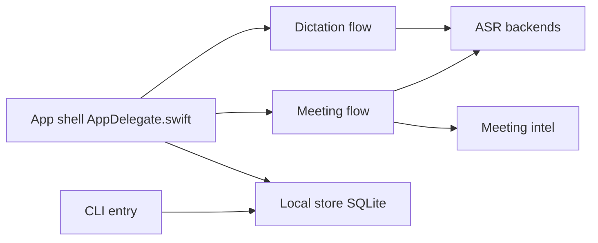

# pHequals7/muesli

> macOS application for voice dictation and meeting transcription, running locally on Apple Silicon by default.

## The problem
Dictating or transcribing meetings often goes through a cloud service that receives the audio, or through tools that require a bot in the call.

## What it actually does
Hotkey dictation with the transcription pasted at the cursor (Parakeet, about 0.13 s), and meeting transcription capturing microphone and system audio, with diarization and speech detection. Meeting notes via OpenAI, OpenRouter, a ChatGPT subscription or local Ollama. Many engines (Parakeet, Whisper, Nemotron, Qwen3 ASR, Cohere Transcribe). An agent-readable `muesli-cli` CLI exposes meetings, dictations and file transcription. iCloud sync of text only.

## How it is wired


## Trying it
```bash
brew install --cask muesli
muesli-cli transcribe interview.mp3
muesli-cli meetings list --limit 10
muesli-cli transcribe interview.mp4 --summarize --format markdown --output notes.md
```

## Cost and gotchas
Free locally, but macOS and Apple Silicon are required; models from 150 MB to 3.8 GB downloaded from HuggingFace. The hosted options (OpenAI, OpenRouter) send audio or text and are at your expense. Many macOS permissions.

## What it is not
Not cross-platform, not a cloud service. The "Computer Use" mode can execute actions on your machine from voice commands; enable it knowingly.

## Alternatives
No alternative named in the README (WisprFlow and Granola are cited as feature references).

## For you
Worth watching: interesting if you are on a Mac and want local meeting transcription that can be scripted, but the project is moving fast, with 103 open issues and a single maintainer.
