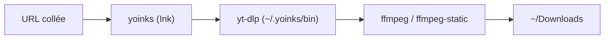

# pablostanley/yoinks

> A terminal video downloader on top of yt-dlp, for anyone who wants to save videos.

## The problem
Online download sites impose popups and fake buttons; yt-dlp alone requires knowing its options.

## What it actually does
You paste a URL, choose a resolution or mp3 audio in a full-screen interface (Ink, React for the terminal), and the file lands in `~/Downloads`. It downloads the yt-dlp binary into `~/.yoinks/bin` on first launch and uses ffmpeg from the PATH, otherwise `ffmpeg-static`.

## How it is wired


## Trying it
```bash
npm install -g yoinks
npx yoinks
yoinks https://youtu.be/dQw4w9WgXcQ
yoinks --theme light
```

## Cost and gotchas
Free, Node 18 or later. Created in July 2026, young. Downloading may violate a platform's terms, as the README points out.

## What it is not
Not a download engine of its own: it wraps yt-dlp. Not a tool for archiving content you have no rights to.

## Alternatives
- yt-dlp: the underlying tool, with more options.

## For you
Ignore: a terminal convenience unrelated to data or AI pipelines, and too recent to rely on.
