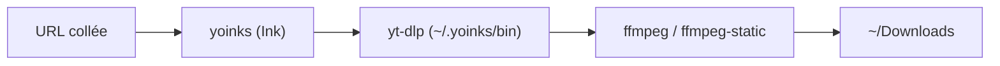

# pablostanley/yoinks

> Un téléchargeur de vidéos en terminal au-dessus de yt-dlp, pour qui veut sauvegarder des vidéos.

## Le problème
Les sites de téléchargement en ligne imposent popups et faux boutons ; yt-dlp seul demande de connaître ses options.

## Ce que ça fait vraiment
On colle une URL, on choisit une résolution ou l'audio mp3 dans une interface plein écran (Ink, React pour terminal), et le fichier arrive dans `~/Downloads`. Il télécharge le binaire yt-dlp dans `~/.yoinks/bin` au premier lancement et utilise ffmpeg du PATH, sinon `ffmpeg-static`.

## Comment c'est branché


## Essayer
```bash
npm install -g yoinks
npx yoinks
yoinks https://youtu.be/dQw4w9WgXcQ
yoinks --theme light
```

## Coût et pièges
Gratuit, Node 18 ou plus. Créé en juillet 2026, jeune. Le télécharger peut violer les conditions d'une plateforme, le README le rappelle.

## Ce que ce n'est pas
Pas un moteur de téléchargement propre : il enveloppe yt-dlp. Pas un outil d'archivage de contenu dont on n'a pas les droits.

## Alternatives
- yt-dlp : l'outil sous-jacent, plus complet en options.

## Pour toi
À ignorer : un confort de terminal sans lien avec les pipelines data ou IA, et trop récent pour s'y fier.

