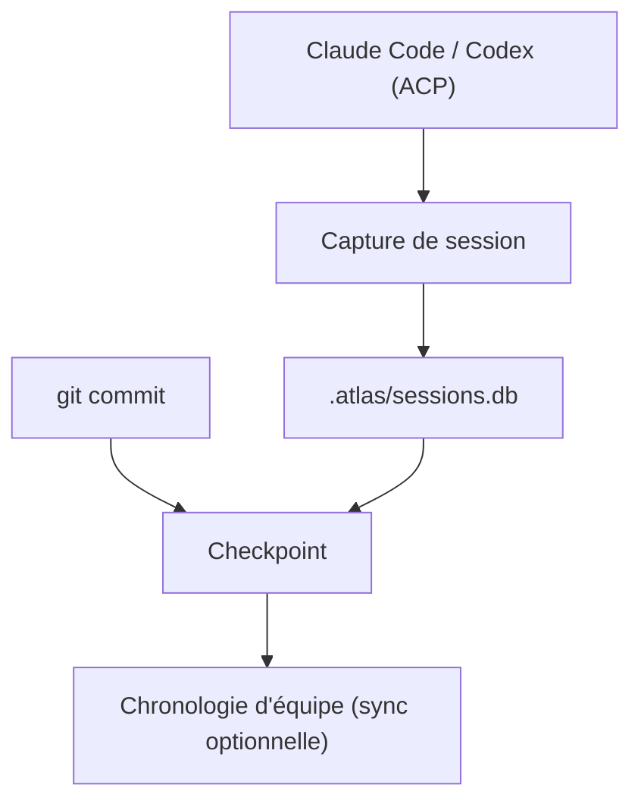

# pacifio/atlas

> Control IDE that records coding-agent sessions and links them to the commits they produce.

## The problem
When an agent modifies production code, you don't know who launched it, or with what instruction.

## What it actually does
Atlas (Tauri, Rust, Bun) records each session in `.atlas/sessions.db`, with secrets masked before writing, then links each commit to its session as a "checkpoint", even after a rebase. It provides memory shared between agents, a team timeline, comments and a per-commit cost dashboard. Claude Code and Codex run via ACP. Capture is disabled by default.

## How it is wired


## Trying it
```bash
curl -fsSL https://github.com/tryatlas/cli/releases/latest/download/install.sh | sh
git clone https://github.com/tryatlas/atlas
cd atlas
bun install
bun run dev:app
```

## Cost and gotchas
Local mode without an account; the native Atlas agent requires a connected organization. Anonymous analytics enabled by default. Building: Bun, Rust and system dependencies.

## What it is not
Not an agent: it wraps yours. The quality of the less common agents in the ACP registry is still being tested.

## Alternatives
No alternative named in the README.

## For you
Watch: prompt-to-commit traceability is useful for auditing generated code, but the project is young and analytics are on by default.
