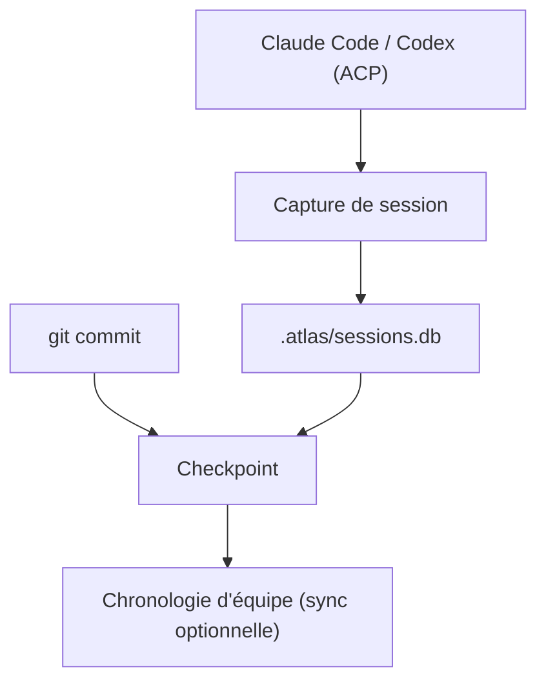

# pacifio/atlas

> IDE de contrôle qui enregistre les sessions d'agents de code et les lie aux commits produits.

## Le problème
Quand un agent modifie du code en production, on ne sait pas qui l'a lancé, ni avec quelle consigne.

## Ce que ça fait vraiment
Atlas (Tauri, Rust, Bun) enregistre chaque session dans `.atlas/sessions.db`, avec secrets masqués avant écriture, puis lie chaque commit à sa session sous forme de « checkpoint », même après rebase. Il fournit une mémoire partagée entre agents, une chronologie d'équipe, des commentaires et un tableau de coût par commit. Claude Code et Codex tournent via ACP. La capture est désactivée par défaut.

## Comment c'est branché


## Essayer
```bash
curl -fsSL https://github.com/tryatlas/cli/releases/latest/download/install.sh | sh
git clone https://github.com/tryatlas/atlas
cd atlas
bun install
bun run dev:app
```

## Coût et pièges
Mode local sans compte ; l'agent natif Atlas exige une organisation connectée. Analytique anonyme activée par défaut. Compilation : Bun, Rust et dépendances système.

## Ce que ce n'est pas
Pas un agent : il enveloppe les tiens. La qualité des agents moins courants du registre ACP est encore en test.

## Alternatives
Aucune alternative nommée dans le README.

## Pour toi
Surveiller : la traçabilité prompt-commit est utile pour auditer du code généré, mais le projet est jeune et l'analytique est active par défaut.

