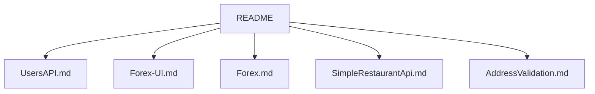

# paidy/interview

> Take-home exercises offered by Paidy to developer, platform, front-end and product candidates.

## The problem
Evaluating a candidate on real work requires well-framed but open-ended assignments.

## What it actually does
Five assignments: a user management API, an exchange-rate SPA, a local exchange-rate proxy, a restaurant API, choosing an address validation provider (product role). The README describes the expectations (simple code, production level), submission through a Git repo and the FAQ. Each brief is in a separate file.

## How it is wired
Simplified diagram based on the fiche, no diagram provided.


## Trying it
```bash
# Aucune commande : on choisit un énoncé, on code, on envoie le lien du dépôt.
```

## Cost and gotchas
Free, but each exercise takes several hours. No license declared. Last push in December 2024.

## What it is not
Not a tool or a library, and no solutions: these are briefs. The recruiter assigns only one exercise per candidate.

## Alternatives
No alternative named in the README.

## For you
To ignore: useful only if you apply at Paidy; no value for data, AI or MLOps work.
