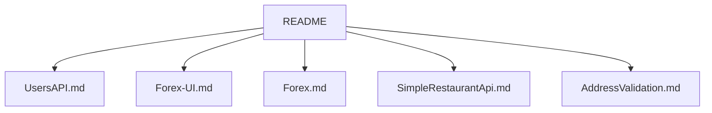

# paidy/interview

> Exercices à faire chez soi proposés par Paidy aux candidats développeurs, plateforme, front et produit.

## Le problème
Évaluer un candidat sur du travail réel demande des sujets cadrés mais ouverts.

## Ce que ça fait vraiment
Cinq sujets : API de gestion d'utilisateurs, SPA de taux de change, proxy local de taux de change, API de restaurant, choix d'un fournisseur de validation d'adresse (poste produit). Le README décrit les attentes (code simple, niveau production), la remise par dépôt Git et la FAQ. Chaque énoncé est dans un fichier à part.

## Comment c'est branché
Schéma simplifié d'après la fiche, sans diagramme fourni.


## Essayer
```bash
# Aucune commande : on choisit un énoncé, on code, on envoie le lien du dépôt.
```

## Coût et pièges
Gratuit, mais chaque exercice demande plusieurs heures. Pas de licence déclarée. Dernier push en décembre 2024.

## Ce que ce n'est pas
Pas un outil ni une bibliothèque, et pas de corrigé : ce sont des énoncés. Le recruteur indique un seul exercice par candidat.

## Alternatives
Aucune alternative nommée dans le README.

## Pour toi
À ignorer : utile seulement si tu postules chez Paidy ; aucun apport pour un travail data, IA ou MLOps.

