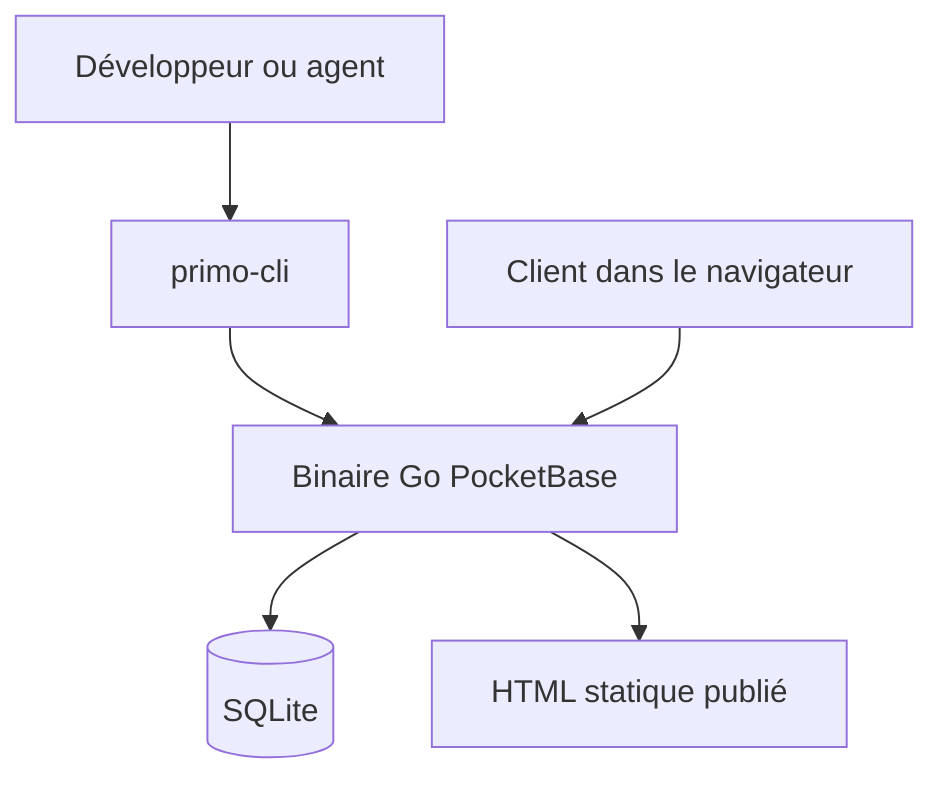

# palacms/palacms

> Open-source CMS for developers, where clients edit content in a visual editor.

## The problem
Delivering a site to a client forces a choice between code that is hard for them to edit and a CMS that limits the developer.

## What it actually does
A single Go binary with PocketBase and SQLite, plus Svelte 5 for the editor and blocks. Sites are edited visually or as synced local files (`primo pull`, `push`, `publish`). Multiple sites per dashboard, static HTML publishing, and MCP tools for coding agents.

## How it is wired
Simplified diagram based on the sheet, no diagram provided.



## Trying it
```bash
npm install -g primo-cli
primo init my-workspace
cd my-workspace
primo new my-site
docker run -d -p 8080:8080 -v primo-data:/app/pb_data ghcr.io/primocms/primo:latest
```

## Cost and gotchas
Free; Node LTS for the CLI, Docker or Railway for a server. The CLI and local-files workflow is in beta. Editors remain trusted publishers: an editor can upload executable compiled code.

## What it is not
Not a data or AI tool: it is a website CMS. Roles protect the design source code, not against a malicious editor.

## Alternatives
The README cites WordPress, Webflow, Astro and headless CMSs in a comparison page, without detail.

## For you
Ignore: useful for client sites, but unrelated to your data / AI / MLOps work.
