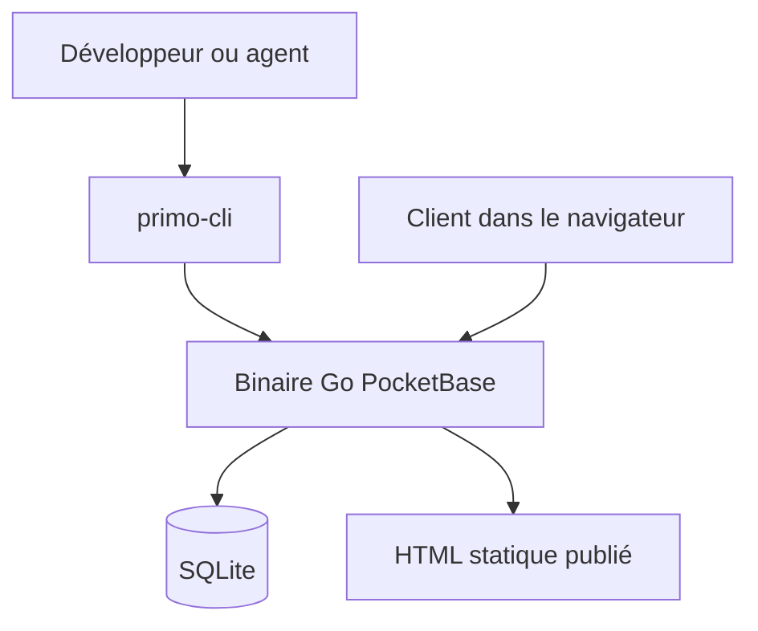

# palacms/palacms

> CMS libre pour développeurs, où les clients modifient le contenu dans un éditeur visuel.

## Le problème
Livrer un site à un client oblige à choisir entre du code difficile à éditer pour lui et un CMS qui limite le développeur.

## Ce que ça fait vraiment
Un seul binaire Go avec PocketBase et SQLite, plus Svelte 5 pour l'éditeur et les blocs. Les sites sont édités visuellement ou en fichiers locaux synchronisés (`primo pull`, `push`, `publish`). Plusieurs sites par tableau de bord, publication en HTML statique, et outils MCP pour les agents de code.

## Comment c'est branché
Schéma simplifié d'après la fiche, sans diagramme fourni.



## Essayer
```bash
npm install -g primo-cli
primo init my-workspace
cd my-workspace
primo new my-site
docker run -d -p 8080:8080 -v primo-data:/app/pb_data ghcr.io/primocms/primo:latest
```

## Coût et pièges
Gratuit ; Node LTS pour la CLI, Docker ou Railway pour un serveur. Le flux CLI et fichiers locaux est en bêta. Les éditeurs restent des publieurs de confiance : un éditeur peut téléverser du code compilé exécutable.

## Ce que ce n'est pas
Pas un outil de données ni d'IA : c'est un CMS de sites web. Les rôles protègent le code source du design, pas contre un éditeur malveillant.

## Alternatives
Le README cite WordPress, Webflow, Astro et les CMS headless dans une page de comparaison, sans détailler.

## Pour toi
À ignorer : utile pour des sites clients, mais sans lien avec ton travail data / IA / MLOps.

