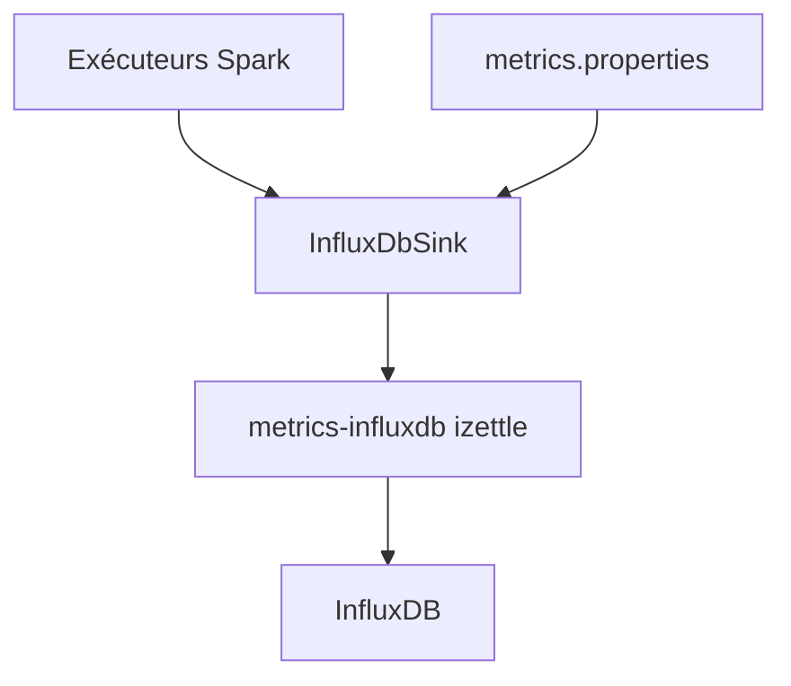

# palantir/spark-influx-sink

> Spark metrics sink that pushes to InfluxDB, for anyone monitoring Spark jobs.

## The problem
Collecting metrics from Spark executors spread across remote hosts is painful when polling them or reading logs.

## What it actually does
An `InfluxDbSink` class that Spark loads via `conf/metrics.properties`. Executors push their metrics to a central InfluxDB. It relies on iZettle's `dropwizard-metrics-influxdb` library, and lives in the `org.apache.spark.metrics.sink` package because Spark's Sink interface is package-private.

## How it is wired
Simplified diagram based on the sheet, no diagram provided.



## Trying it
```bash
./gradlew build
```
Then copy the JAR into Spark's `extraClassPath` and add the `*.sink.influx.*` lines to `conf/metrics.properties`.

## Cost and gotchas
Free. An accessible InfluxDB is required; building requires Gradle and Java (not specified in the prerequisites list). Last push in 2021, so tied to old Spark versions.

## What it is not
Not a dashboard: it only sends the metrics. No announced compatibility with recent Spark.

## Alternatives
None cited in the README.

## For you
Ignore: archived since 2021; Spark now exposes other metrics sinks.
