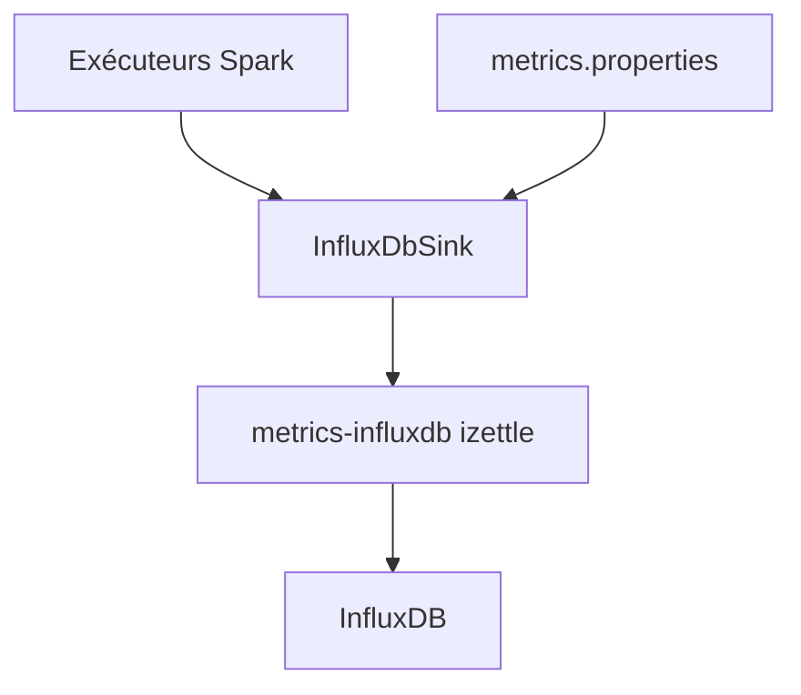

# palantir/spark-influx-sink

> Sink de métriques Spark qui pousse vers InfluxDB, pour qui supervise des jobs Spark.

## Le problème
Collecter les métriques d'exécuteurs Spark répartis sur des hôtes distants est pénible en les interrogeant ou en lisant les logs.

## Ce que ça fait vraiment
Une classe `InfluxDbSink` que Spark charge via `conf/metrics.properties`. Les exécuteurs poussent leurs métriques vers un InfluxDB central. Elle s'appuie sur la bibliothèque `dropwizard-metrics-influxdb` d'iZettle, et vit dans le paquet `org.apache.spark.metrics.sink` parce que l'interface Sink de Spark est privée au paquet.

## Comment c'est branché
Schéma simplifié d'après la fiche, sans diagramme fourni.



## Essayer
```bash
./gradlew build
```
Puis copier le JAR dans le `extraClassPath` de Spark et ajouter les lignes `*.sink.influx.*` à `conf/metrics.properties`.

## Coût et pièges
Gratuit. Il faut un InfluxDB accessible ; la compilation demande Gradle et Java (non précisé dans la liste des prérequis). Dernier push en 2021, donc calé sur d'anciennes versions de Spark.

## Ce que ce n'est pas
Pas un tableau de bord : il envoie seulement les métriques. Pas de compatibilité annoncée avec Spark récent.

## Alternatives
Aucune citée dans le README.

## Pour toi
À ignorer : archivé depuis 2021 ; Spark expose aujourd'hui d'autres sinks de métriques.

