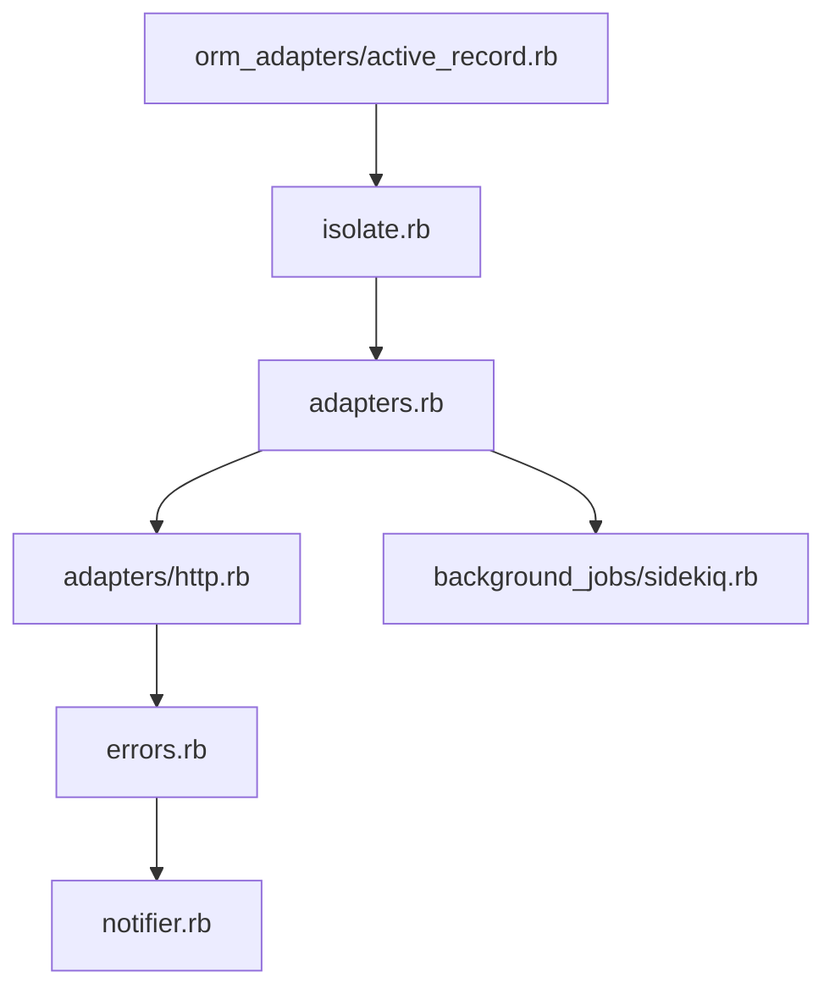

# palkan/isolator

> Ruby gem that detects HTTP calls or background jobs fired inside a database transaction.

## The problem
An external call or a job sent before the commit may run on data that gets rolled back.

## What it actually does
It detects when an ActiveRecord transaction opens, then raises a typed error (HTTPError, BackgroundJobError) if an HTTP call, Sidekiq, ActiveJob, Resque, mailer or ActionCable call occurs. Meant for tests and staging. Adapters can be disabled, ignore lists live in YAML, and custom adapters are possible.

## How it is wired


## Trying it
```ruby
group :development, :test do
  gem "isolator"
end
```

## Cost and gotchas
Free. Gem load order matters (require it last). Tricky interactions with sidekiq/testing and Combustion.

## What it is not
Not a production tool: it targets tests and staging. Ruby and Rails only.

## Alternatives
after_commit_everywhere or the native after_commit callbacks, cited for fixing violations.

## For you
Ignore: useful for a Rails codebase, outside the data / AI / MLOps scope.
