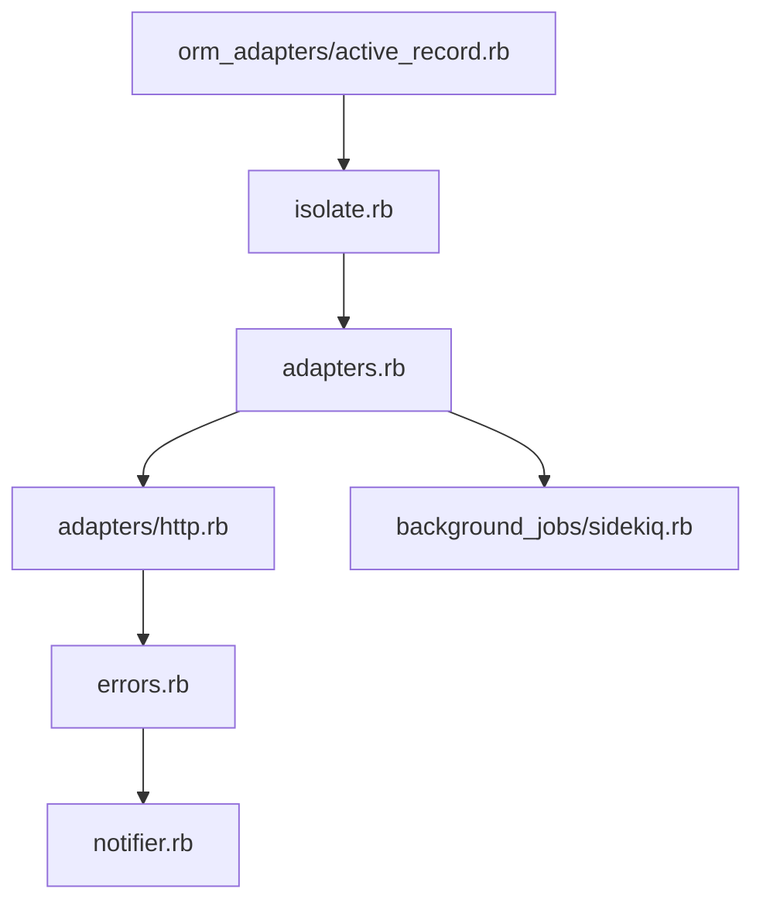

# palkan/isolator

> Gem Ruby qui détecte les appels HTTP ou jobs en arrière-plan lancés dans une transaction de base.

## Le problème
Un appel externe ou un job envoyé avant le commit peut s'exécuter sur des données annulées.

## Ce que ça fait vraiment
Il détecte l'ouverture d'une transaction ActiveRecord, puis lève une erreur typée (HTTPError, BackgroundJobError) si un appel HTTP, Sidekiq, ActiveJob, Resque, mailer ou ActionCable survient. Destiné aux tests et à la préproduction. Adaptateurs désactivables, listes d'ignores en YAML et adaptateurs personnalisés possibles.

## Comment c'est branché


## Essayer
```ruby
group :development, :test do
  gem "isolator"
end
```

## Coût et pièges
Gratuit. L'ordre de chargement des gems compte (le requérir en dernier). Interactions délicates avec sidekiq/testing et Combustion.

## Ce que ce n'est pas
Pas un outil de production : il vise tests et staging. Ruby et Rails seulement.

## Alternatives
after_commit_everywhere ou les callbacks natifs after_commit, cités pour corriger les infractions.

## Pour toi
Ignorer : utile pour une base Rails, hors périmètre data / IA / MLOps.

