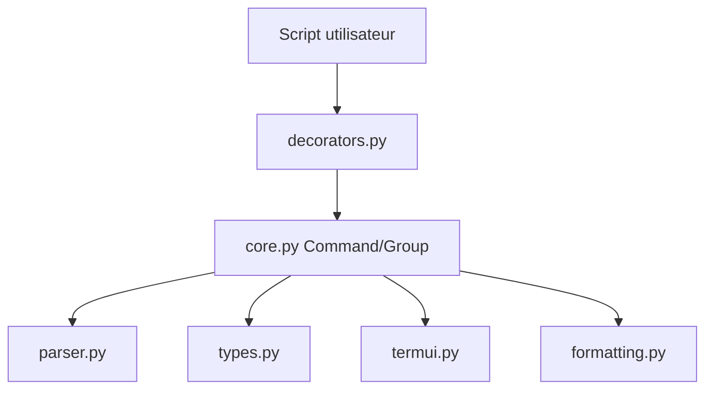

# pallets/click

> Python library for building composable command-line interfaces with as little code as possible.

## The problem
Parsing arguments, generating help, handling subcommands and completion by hand is repetitive and error-prone.

## What it actually does
Decorators (`@click.command`, `@click.option`) turn a function into a command. Click allows arbitrary nesting of commands, generates help, supports lazy loading of subcommands, interactive prompts, shell completion and a test harness (`click.testing`). According to the architecture, it has no external dependency.

## How it is wired


## Trying it
```python
import click

@click.command()
@click.option("--count", default=1, help="Number of greetings.")
@click.option("--name", prompt="Your name", help="The person to greet.")
def hello(count, name):
    for _ in range(count):
        click.echo(f"Hello, {name}!")
```
```bash
python hello.py --count=3
```

## Cost and gotchas
Free. The README gives no installation command (usual pip, not documented here).

## What it is not
It is not a CLI generator from types: declaration goes through explicit decorators.

## Alternatives
Typer, in this batch, is built on type annotations and now integrates Click code.

## For you
Adopt: the standard base of the Python CLIs you will meet across the ML ecosystem; knowing it avoids surprises.
