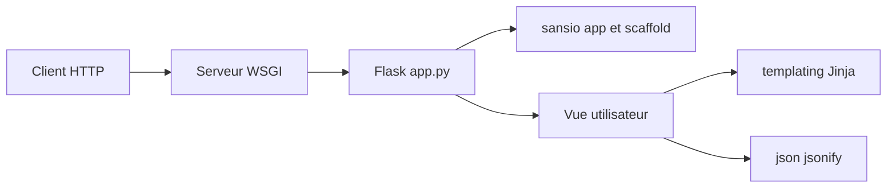

# pallets/flask

> Python web micro-framework for serving an application or an API, without imposing any structure.

## The problem
Exposing a Python function over HTTP (a model, a dashboard, an API) requires a WSGI framework without tying yourself to a heavy one.

## What it actually does
Flask wraps Werkzeug (routing, HTTP) and Jinja (templates). You declare routes with decorators, blueprints, error handlers, template and JSON rendering, and signed-cookie sessions (itsdangerous). The framework fixes neither a database nor a project layout; community extensions fill the gaps.

## How it is wired


## Trying it
```python
# save this as app.py
from flask import Flask

app = Flask(__name__)

@app.route("/")
def hello():
    return "Hello, World!"
```
```bash
flask run
```

## Cost and gotchas
Free. The built-in `flask run` server is for development; a separate WSGI server is needed (the README does not detail deployment).

## What it is not
It is not a full-stack framework: no ORM, authentication or administration provided.

## Alternatives
No alternative named in the README.

## For you
Adopt: the shortest way to put a model behind an HTTP API, and a widely known foundation.
