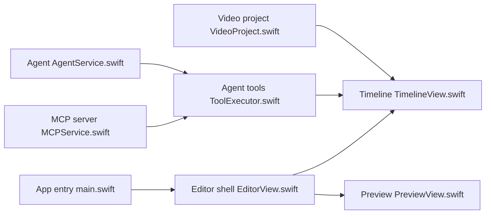

# palmier-io/palmier-pro

> Native macOS video editor with AI generation and an MCP server to drive the timeline from an agent.

## The problem
Video editors do not let an AI agent directly manipulate a timeline or generate shots inside it.

## What it actually does
Swift editor (timeline, preview, inspector, ripple/snap engines).
Image/video generation through a backend (Seedance, Kling, Nano Banana Pro), with an account and credits.
Built-in agent and a local MCP server at `127.0.0.1:19789/mcp` exposing typed tools.
Visual search by embeddings, transcription, XML export.

## How it is wired


## Trying it
```bash
claude mcp add --transport http palmier-pro http://127.0.0.1:19789/mcp
codex mcp add palmier-pro --url http://127.0.0.1:19789/mcp
```

## Cost and gotchas
macOS 26 on Apple Silicon only; AI generation through a closed backend with credits; telemetry present in the code.

## What it is not
No longer really open source: GPL up to v0.7.6, later binaries are proprietary with no published source.

## Alternatives
No alternative named in the README.

## For you
Ignore: a macOS creative tool whose current version is closed, of no interest for a data pipeline.
