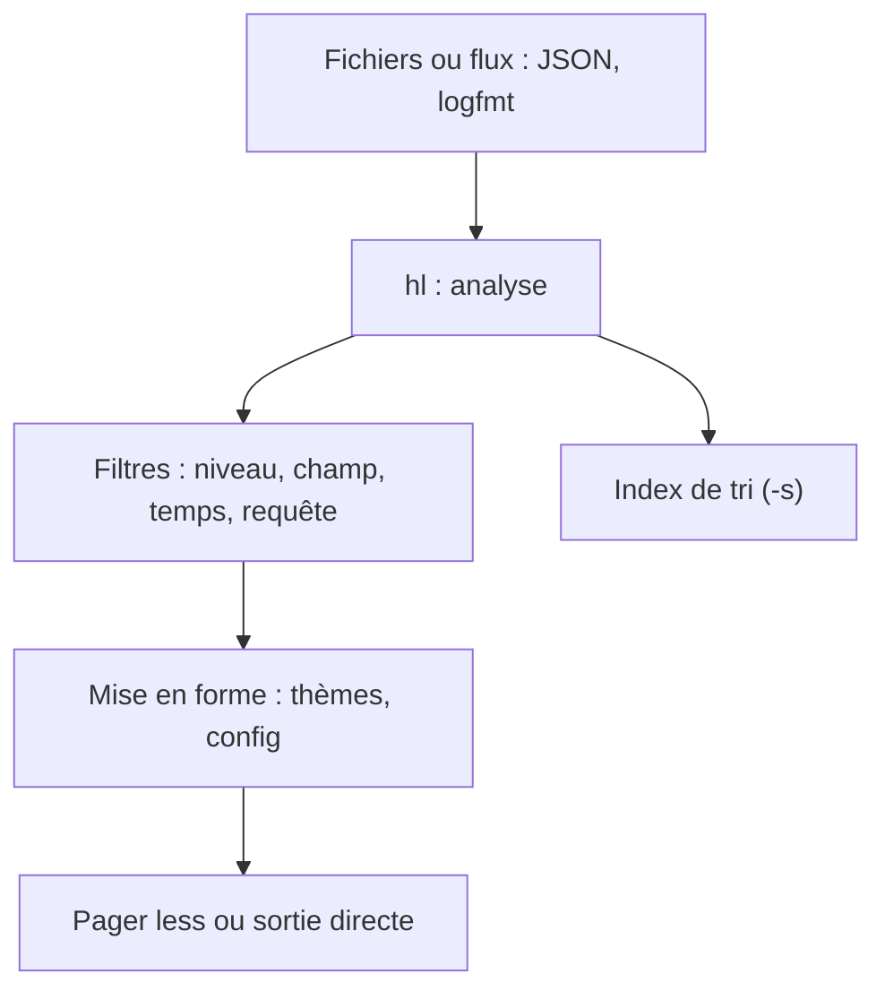

# pamburus/hl

> Command-line log reader that makes JSON and logfmt readable, filterable and sorted.

## The problem
Raw JSON logs are unreadable, and filtering or sorting several large files with grep is slow and painful.

## What it actually does
It colors and formats JSON and logfmt logs, with an automatic pager. It filters by level, field, time range or query (`--query 'level > info or status-code >= 400'`). It sorts by time using an index, follows several sources live (`-F`) and supports themes.

## How it is wired
Simplified diagram based on the sheet, no diagram provided.



## Trying it
```bash
brew install hl
hl *.log
hl -l e example.log
hl -s *.log
hl -F --tail 100 app1.log app2.log
```

## Cost and gotchas
Free, no service. On Windows, install `less` via Scoop or Chocolatey; the build of the download site and of WinGet breaks some ANSI sequences.

## What it is not
Not a log aggregation system or distributed search: it reads local files and streams. No built-in pager.

## Alternatives
humanlog, hlogf and fblog, cited in the README's performance comparison.

## For you
Adopt: a light and fast tool for reading the logs of ML services, pipelines or `kubectl logs`.
