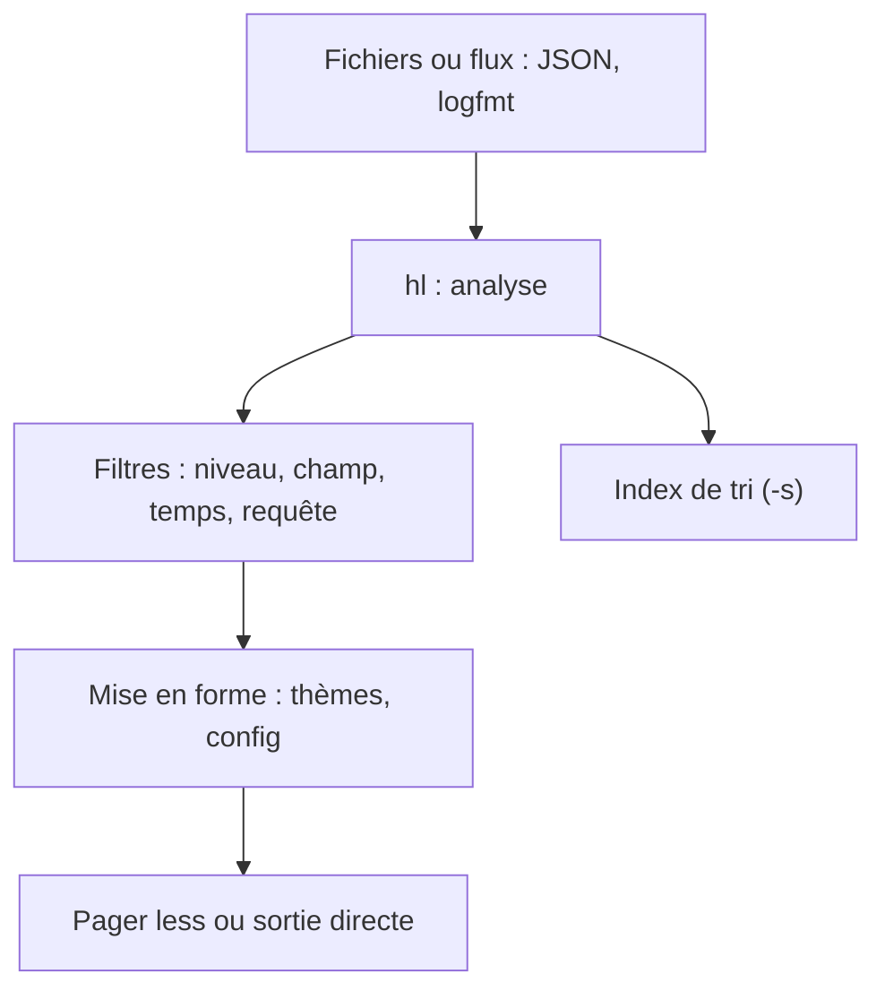

# pamburus/hl

> Lecteur de journaux en ligne de commande qui rend JSON et logfmt lisibles, filtrables et triés.

## Le problème
Les logs JSON bruts sont illisibles, et filtrer ou trier plusieurs gros fichiers au grep est lent et pénible.

## Ce que ça fait vraiment
Il colore et met en forme les logs JSON et logfmt, avec pager automatique. Il filtre par niveau, champ, plage horaire ou requête (`--query 'level > info or status-code >= 400'`). Il trie par date avec un index, suit plusieurs sources en direct (`-F`) et accepte des thèmes.

## Comment c'est branché
Schéma simplifié d'après la fiche, sans diagramme fourni.



## Essayer
```bash
brew install hl
hl *.log
hl -l e example.log
hl -s *.log
hl -F --tail 100 app1.log app2.log
```

## Coût et pièges
Gratuit, sans service. Sous Windows, installer `less` via Scoop ou Chocolatey ; le build du site de téléchargement et de WinGet casse certaines séquences ANSI.

## Ce que ce n'est pas
Pas un système d'agrégation de logs ni de recherche distribuée : il lit des fichiers et flux locaux. Pas de pager intégré.

## Alternatives
humanlog, hlogf et fblog, cités dans la comparaison de performance du README.

## Pour toi
À adopter : outil léger et rapide pour lire les logs de services ML, de pipelines ou de `kubectl logs`.

