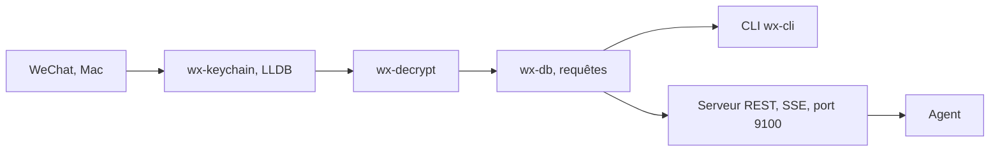

# pandorafuture/wx-cli

> Command line that reads WeChat's local data on Mac to expose it to agents.

## The problem
WeChat messages remain locked in a local encrypted database, inaccessible to an agent or a script.

## What it actually does
It extracts the key of WeChat's encrypted database via an LLDB hook, decrypts the databases locally, then lets you search, query and export messages and extract images, voice and videos. A REST server with an SSE stream broadcasts new messages. A rule hides certain contacts; an agent skill is provided.

## How it is wired


## Trying it
```bash
wx-cli doctor
wx-cli key extract --timeout 120
wx-cli decrypt
wx-cli search 周末 --limit 20
wx-cli server run
```

## Cost and gotchas
Free, but key extraction requires disabling SIP, which weakens the Mac's security. Only macOS arm64 is supported, with WeChat 4.1.7 or later. A server exposed on the network must have a token.

## What it is not
Not an official WeChat tool, nor portable to Windows or Linux. It reads your own data: reading anyone else's may raise a legal issue. The README is in Chinese.

## Alternatives
No alternative named in the README.

## For you
Ignore: disabling SIP and bypassing a messaging app's encryption is a high risk, for a use far from your data, AI or MLOps scope.
