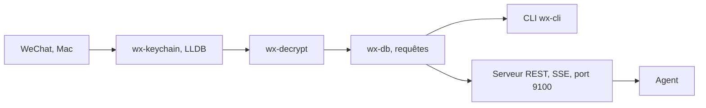

# pandorafuture/wx-cli

> Ligne de commande qui lit les données locales de WeChat sur Mac pour les exposer à des agents.

## Le problème
Les messages WeChat restent enfermés dans une base chiffrée locale, inaccessibles à un agent ou à un script.

## Ce que ça fait vraiment
Il extrait la clé de la base chiffrée de WeChat via un crochet LLDB, déchiffre les bases en local, puis permet de chercher, interroger, exporter les messages et d'extraire images, voix et vidéos. Un serveur REST avec flux SSE diffuse les nouveaux messages. Une règle masque certains contacts ; un skill d'agent est fourni.

## Comment c'est branché


## Essayer
```bash
wx-cli doctor
wx-cli key extract --timeout 120
wx-cli decrypt
wx-cli search 周末 --limit 20
wx-cli server run
```

## Coût et pièges
Gratuit, mais l'extraction de clé exige de désactiver SIP, ce qui affaiblit la sécurité du Mac. Seul macOS arm64 est pris en charge, avec WeChat 4.1.7 ou plus. Le serveur ouvert sur le réseau doit avoir un jeton.

## Ce que ce n'est pas
Pas un outil officiel de WeChat ni portable sur Windows ou Linux. Il lit tes propres données : en lire d'autres peut poser un problème légal. Le README est en chinois.

## Alternatives
Aucune alternative nommée dans le README.

## Pour toi
À ignorer : désactiver SIP et contourner le chiffrement d'une messagerie est un risque élevé, pour un usage éloigné de ton périmètre data, IA ou MLOps.

