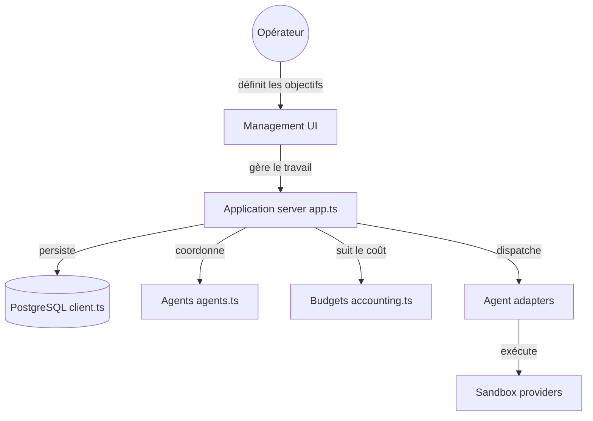

# paperclipai/paperclip

> A Node.js server and a React interface that orchestrate a team of AI agents, each with assigned tasks, budgets, and validation procedures.

## The problem
With twenty Claude Code terminals open, it's no longer clear who is working on what, or how much it costs. Sessions are lost each time the system is restarted.

## What it actually does
A task management dashboard type interface where goals are defined and agents (Claude Code, Codex, Cursor, Gemini CLI, HTTP bots) are "hired." It manages an organizational chart, tickets with support lock, budgets with automatic shutdown, scheduled routines, approvals, and an activity log. Agents are "woken up" by "heartbeats." A PostgreSQL database is created upon the first launch.

## How it is wired


## Trying it
```bash
npx paperclipai@latest onboard --yes
# ou, depuis les sources
git clone https://github.com/paperclipai/paperclip.git
cd paperclip
pnpm install
pnpm dev
```

## Cost and gotchas
Node.js 24.11 or later, pnpm 9.15 for sources, and Rust for the native runner (in development). Agents use your own subscriptions or API keys. Anonymous telemetry is enabled by default; it can be disabled with `PAPERCLIP_TELEMETRY_DISABLED=1` or `DO_NOT_TRACK=1`.

## What it is not
This is not a framework for building agents; it orchestrates those that already exist. It is also not a simple chatbot or a prompt manager.

## Alternatives
The README does not mention any direct alternatives. Instead, it positions itself in relation to OpenClaw and Claude Code, which it supports rather than replacing.

## For you
It's important to monitor if you're working with multiple code agents and need to track costs, but the ecosystem is still relatively new (created in March 2026) and there are 6,400 open issues.
