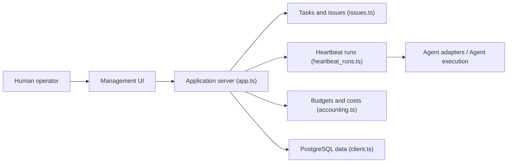

# paperclipai/paperclip

> Serveur Node et interface React pour piloter des équipes d'agents IA avec tâches, budgets et gouvernance.

## Le problème
Avec vingt terminaux d'agents ouverts, on perd le fil des tâches, des coûts et du contexte ; chaque redémarrage efface tout.

## Ce que ça fait vraiment
Paperclip structure des agents (Claude Code, Codex, Cursor, OpenClaw…) en organigramme : tickets avec checkout atomique, objectifs hérités, heartbeats, budgets avec arrêt automatique, approbations, routines planifiées (cron, webhook, API), skills partagés, plusieurs organisations par déploiement. Il ne fournit pas les agents : il les orchestre. Base PostgreSQL embarquée en local.

## Comment c'est branché


## Essayer
```bash
npx paperclipai@latest onboard --yes
ANTHROPIC_API_KEY=... npx paperclipai test-drive
git clone https://github.com/paperclipai/paperclip.git
pnpm install
pnpm dev
```

## Coût et pièges
Node 24.11+, pnpm 9.15+ ; les tokens des agents sont à ta charge. La télémétrie anonyme est activée par défaut (désactivable : `PAPERCLIP_TELEMETRY_DISABLED=1` ou `DO_NOT_TRACK=1`). Plus de 6 400 issues ouvertes.

## Ce que ce n'est pas
Ni un framework d'agents, ni un simple chatbot ou workflow builder. Les promesses « business autonome à 1 M$ de MRR » sont une illustration, pas un résultat démontré.

## Alternatives
- OpenClaw : agent seul, « employé » dont Paperclip est « l'entreprise ».
- Claude Code, Codex, Cursor : les agents que Paperclip orchestre.

## Pour toi
À surveiller : pertinent pour suivre coûts et tâches de plusieurs agents, mais le cadrage « entreprise autonome » est ambitieux ; teste sur un projet interne avec budgets stricts.

