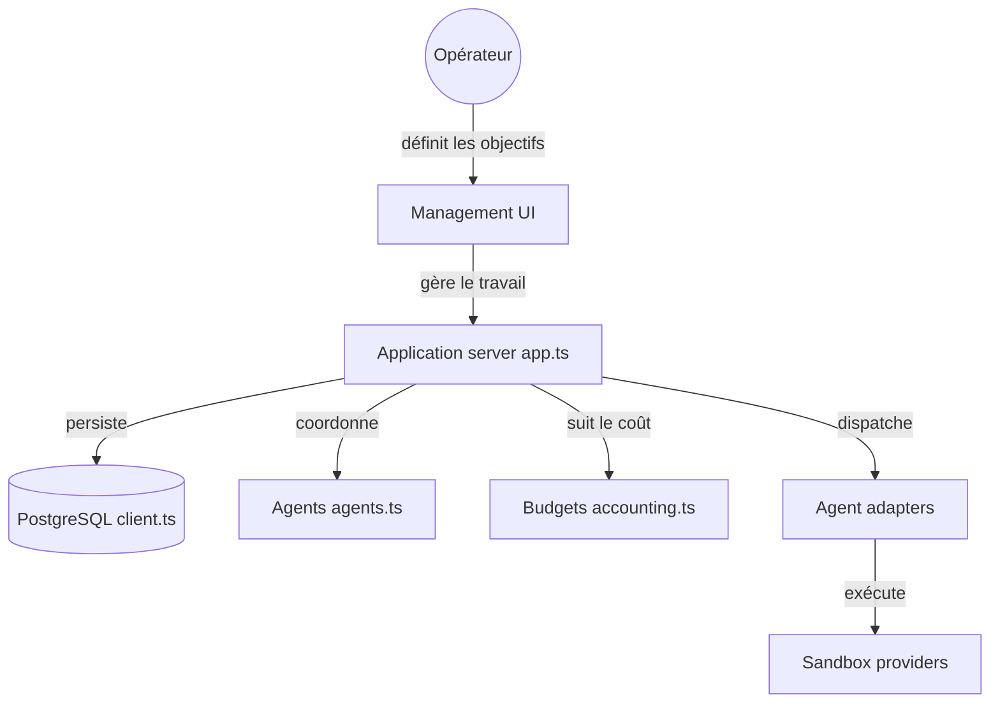

# paperclipai/paperclip

> Serveur Node et interface React qui orchestrent une équipe d'agents IA avec tâches, budgets et validations.

## Le problème
Avec vingt terminaux Claude Code ouverts, on ne sait plus qui travaille sur quoi, ni combien ça coûte. Les sessions se perdent au redémarrage.

## Ce que ça fait vraiment
Un tableau de bord type gestionnaire de tâches où l'on déclare des objectifs et où l'on « embauche » des agents (Claude Code, Codex, Cursor, Gemini CLI, bots HTTP). Il gère un organigramme, des tickets avec verrou de prise en charge, des budgets avec arrêt automatique, des routines planifiées, des approbations et un journal d'activité. Les agents sont réveillés par des « heartbeats ». Une base PostgreSQL embarquée est créée au premier lancement.

## Comment c'est branché


## Essayer
```bash
npx paperclipai@latest onboard --yes
# ou, depuis les sources
git clone https://github.com/paperclipai/paperclip.git
cd paperclip
pnpm install
pnpm dev
```

## Coût et pièges
Node.js 24.11 ou plus, pnpm 9.15 pour les sources, et un Rust pour le runner natif en développement. Les agents consomment vos propres abonnements ou clés d'API. La télémétrie anonyme est active par défaut ; on la coupe avec `PAPERCLIP_TELEMETRY_DISABLED=1` ou `DO_NOT_TRACK=1`.

## Ce que ce n'est pas
Ce n'est pas un framework pour construire des agents : il orchestre ceux qui existent déjà. Ce n'est pas non plus un simple chatbot ni un gestionnaire de prompts.

## Alternatives
Le README ne nomme aucune alternative directe. Il se positionne par rapport à OpenClaw et Claude Code, qu'il pilote au lieu de les remplacer.

## Pour toi
À surveiller si tu jongles avec plusieurs agents de code et veux suivre les coûts, mais l'écosystème est jeune (créé en mars 2026) et 6 400 issues restent ouvertes.

