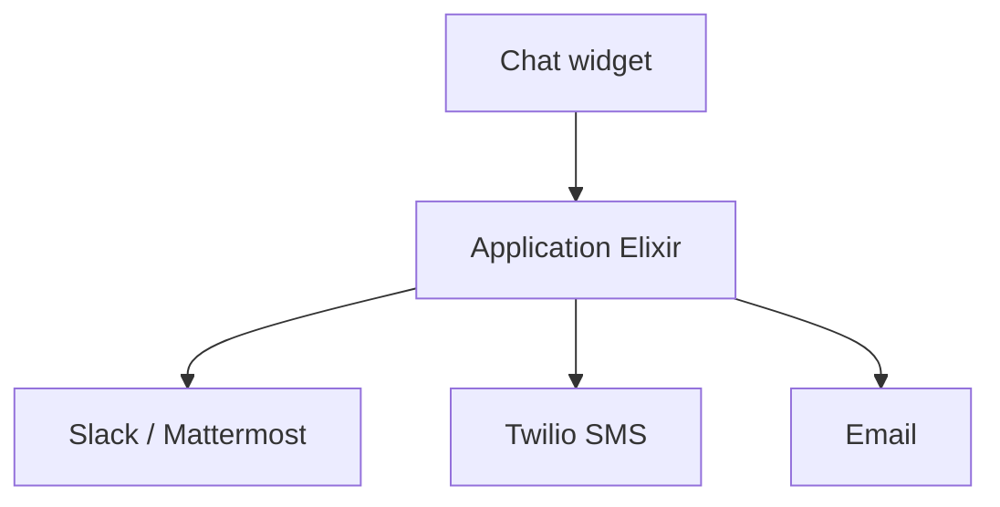

# papercups-io/papercups

> Self-hostable live customer support tool written in Elixir, an Intercom alternative.

## The problem
Customer support tools send data to a third party, which bothers privacy-sensitive companies.

## What it actually does
Embeddable chat widget (React, React Native, Flutter), replies by email and SMS (Twilio), Slack and Mattermost integrations, conversation management, team invitations. A hosted version is offered. The project is in maintenance mode.

## How it is wired

Diagram based on the README, no diagram provided.

## Trying it
```bash
# non documenté en commande : déploiement Heroku en un clic, docs sur docs.papercups.io
```

## Cost and gotchas
Self-hosting is free; Twilio and email at your expense. Last push February 2024.

## What it is not
Not a living project: no more major new features planned.

## Alternatives
Zendesk and Intercom (cited references).

## For you
Ignore: in maintenance, unrelated to data/AI/MLOps.
