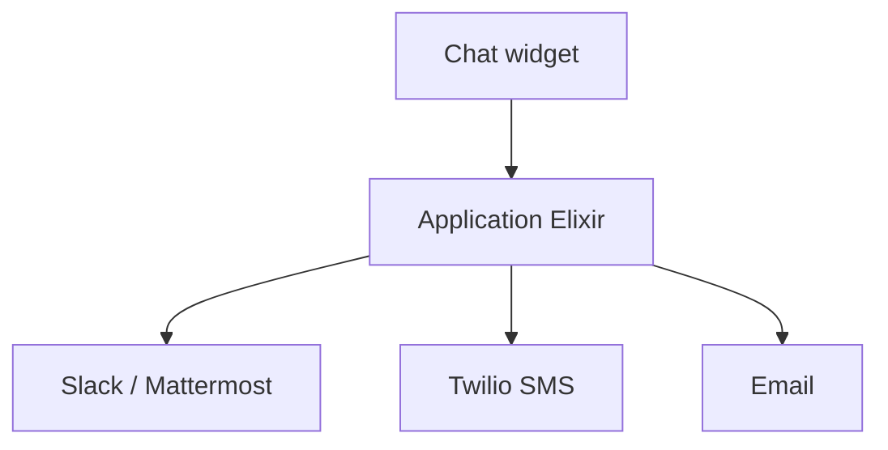

# papercups-io/papercups

> Outil de support client en direct auto-hébergeable, écrit en Elixir, alternative à Intercom.

## Le problème
Les outils de support clients envoient les données chez un tiers, ce qui gêne les entreprises sensibles à la vie privée.

## Ce que ça fait vraiment
Widget de chat intégrable (React, React Native, Flutter), réponses par e-mail et SMS (Twilio), intégrations Slack et Mattermost, gestion des conversations, invitation d'équipe. Version hébergée proposée. Le projet est en mode maintenance.

## Comment c'est branché

Schéma d'après le README, pas de diagramme fourni.

## Essayer
```bash
# non documenté en commande : déploiement Heroku en un clic, docs sur docs.papercups.io
```

## Coût et pièges
Auto-hébergement gratuit ; Twilio et e-mail à ta charge. Dernier push février 2024.

## Ce que ce n'est pas
Pas un projet vivant : plus de nouvelles fonctions majeures prévues.

## Alternatives
Zendesk et Intercom (références citées).

## Pour toi
Ignorer : en maintenance, sans lien avec data/IA/MLOps.

