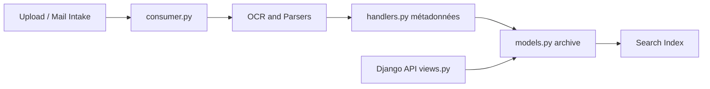

# paperless-ngx/paperless-ngx

> Self-hosted document manager that OCRs and indexes your scanned papers, for individuals.

## The problem
Paper documents (taxes, invoices) pile up, impossible to find, with no full-text search.

## What it actually does
A consumer (`consumer.py`) ingests files dropped in or received by email, parsers do the OCR, handlers apply metadata and filing, then documents and text are stored and indexed. Angular front end, Django API, automation workflows; the architecture also points to a vector index and an AI chat (`vector_store.py`, `chat.py`).

## How it is wired


## Trying it
```bash
bash -c "$(curl -L https://raw.githubusercontent.com/paperless-ngx/paperless-ngx/main/install-paperless-ngx.sh)"
```

## Cost and gotchas
Free, Docker required. The README insists: storage is in clear text, unencrypted; never expose it on an untrusted host, and plan for backups.

## What it is not
Not a secure enterprise document management system, nor a multi-tenant encrypted one. The AI is not described in the README, only in the code.

## Alternatives
None named (the wiki lists compatible projects).

## For you
Adopt it for personal use; the OCR + filing pipeline is worth studying.
