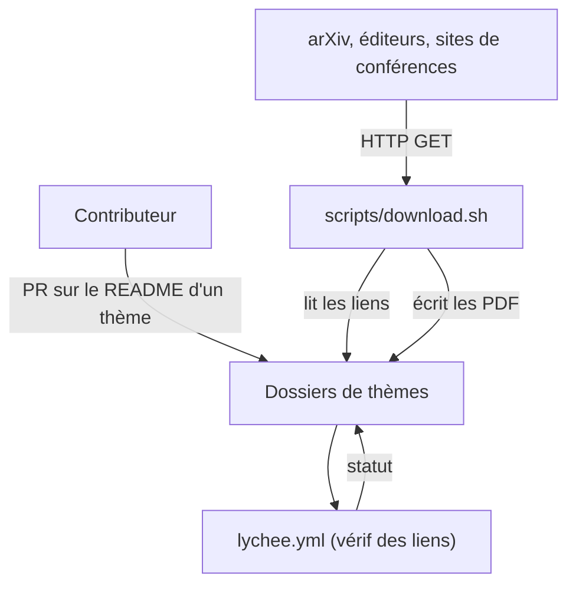

# papers-we-love/papers-we-love

> A community repository of academic computer science papers, sorted by topic, for anyone who wants to read research.

## The problem
Foundational papers are scattered across the web, sometimes behind publishers. Without curation, you don't know which ones are worth reading.

## What it actually does
One folder per major computer science topic, with a README of links to the PDFs. When the license allows it, the PDF is hosted (:scroll: emoji). The `scripts/download.sh` script reads the markdown files and downloads the PDFs into their folders. A CI (lychee) checks the links.

## How it is wired


## Trying it
```bash
./scripts/download.sh
```

## Cost and gotchas
No cost. Downloading depends on external links that can break; the README points to `scripts/README.md` for the options.

## What it is not
Not a paper search engine: it is a list to browse by hand. The "Papers We Love" name and logos are protected, and the repository's license is not declared.

## Alternatives
- eugeneyan/applied-ml: papers focused on applied ML in production.
- arXiv Paper Repository: primary sources, up to date.
- alphaXiv: adds a discussion layer on top of arXiv papers.

## For you
Worth watching: a good pool of background reading (distributed systems, AI), but nothing to integrate into a pipeline.
