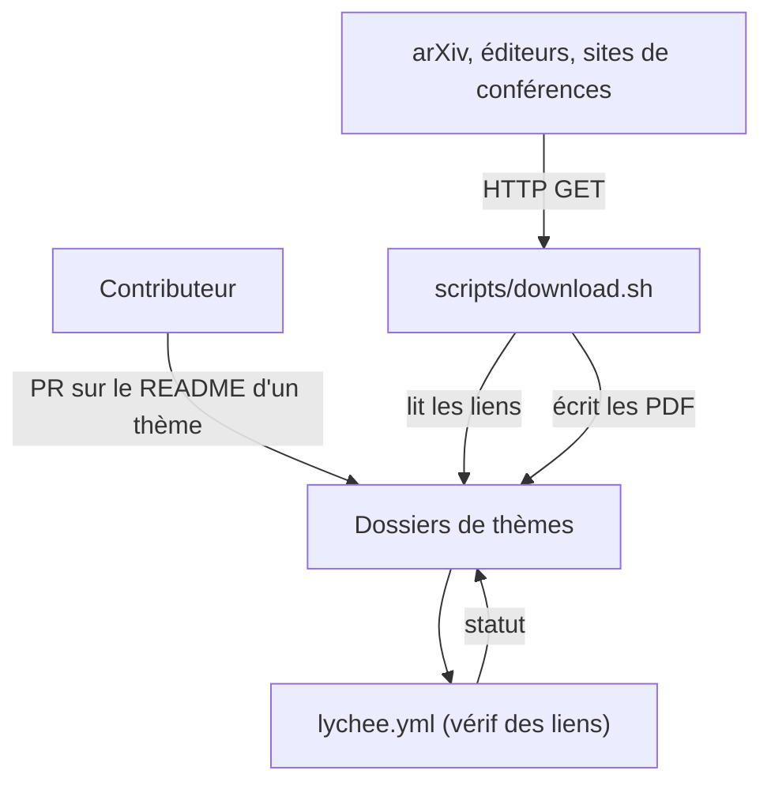

# papers-we-love/papers-we-love

> Répertoire communautaire d'articles académiques d'informatique, classés par thème, pour qui veut lire de la recherche.

## Le problème
Les articles fondateurs sont dispersés sur le web, parfois derrière des éditeurs. Sans curation, on ne sait pas lesquels valent la lecture.

## Ce que ça fait vraiment
Un dossier par grand thème de l'informatique, avec un README de liens vers les PDF. Quand la licence le permet, le PDF est hébergé (emoji :scroll:). Le script `scripts/download.sh` lit les fichiers markdown et télécharge les PDF dans leurs dossiers. Une CI (lychee) vérifie les liens.

## Comment c'est branché


## Essayer
```bash
./scripts/download.sh
```

## Coût et pièges
Aucun coût. Le téléchargement dépend de liens externes qui peuvent casser ; le README renvoie à `scripts/README.md` pour les options.

## Ce que ce n'est pas
Pas un moteur de recherche d'articles : c'est une liste à parcourir à la main. Le nom et les logos « Papers We Love » sont protégés, la licence du dépôt n'est pas déclarée.

## Alternatives
- eugeneyan/applied-ml : articles centrés sur le ML appliqué en production.
- arXiv Paper Repository : sources primaires, à jour.
- alphaXiv : ajoute une couche de discussion sur les articles arXiv.

## Pour toi
À surveiller : bon vivier de lectures de fond (systèmes distribués, IA), mais rien à intégrer dans un pipeline.

