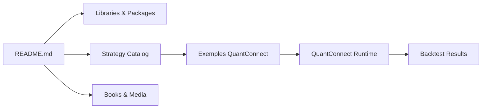

# paperswithbacktest/awesome-systematic-trading

> List of libraries, articles, books and videos for building quantitative trading strategies.

## The problem
Finding, in a sprawling field, tools and published strategies worth testing, while telling dead projects apart.

## What it actually does
A Markdown README groups 136 libraries (backtesting, crypto, indicators, optimization, pricing, data, machine learning) with "dormant" or "archived" projects flagged, 55 books, 22 videos, blogs and courses. A strategy table drawn from coded and executed papers gives Sharpe, t-stat, volatility and tested duration. The repository also contains QuantConnect examples.

## How it is wired

## Trying it
No command: the content is read in the README.

## Cost and gotchas
Free. The replication figures (median Sharpe 0.37; 48% above t = 1.96; no measurable decay after publication) are the authors' own, detailed on their wiki. Raw Sharpes, before transaction costs, over long histories: do not take them for achievable performance. No license declared.

## What it is not
Not investment advice nor a trading platform. The links point to third-party projects, unaudited, of uneven quality.

## Alternatives
The README cites no other list; it mentions the QuantConnect, backtrader, vectorbt and Freqtrade projects in its categories.

## For you
Watch: a good entry point to explore quantitative finance and applied ML tools, but no license and self-published statistics, so cross-check.
