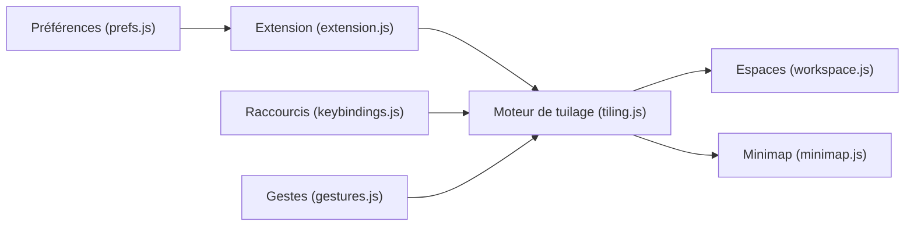

# paperwm/PaperWM

> GNOME Shell extension for scrolling tiling and per-monitor workspaces, for keyboard users.

## The problem
Stacked windows or fixed grids are hard to manage; you want a ribbon of windows that you scroll through like sheets of paper.

## What it actually does
New windows line up to the right of the active window; activation scrolls the ribbon. Vertical columns, a workspace stack shared across monitors, a floating "scratch" layer, minimap, position bar, focus modes, per-window rules (`wm_class`, `title`), multi-window grabbing, trackpad gestures (Wayland). Everything is configured in the preferences or via dconf.

## How it is wired


## Trying it
```bash
make install
make uninstall
nix run .\#vm
```

## Cost and gotchas
Free. Targets GNOME 45 to 50 (the release branch); older versions require another branch. A GNOME Shell restart is required. Incompatible with several extensions (DING, Dash to Panel, Rounded Window Corners…).

## What it is not
It is not a standalone window manager, nor useful outside GNOME. No connection to data or AI.

## Alternatives
Niri, Karousel (KDE), papersway (i3/sway).

## For you
Outside the data/AI scope: of no interest for your work, unless you use GNOME and want a different tiling mode.
