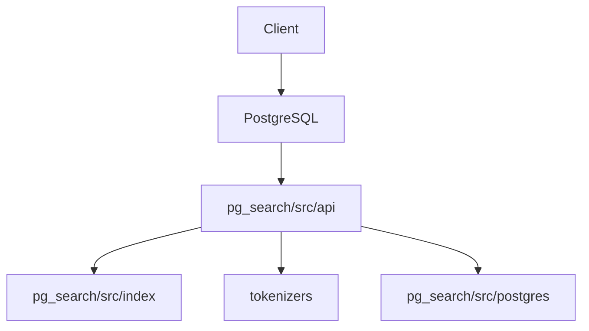

# paradedb/paradedb

> Postgres extension for full-text, vector and analytical search in a single database.

## The problem
Combining an application database, a search engine and analytics means several systems to keep in sync.

## What it actually does
Postgres extension (`pg_search`) in Rust that adds a BM25 index for full-text search, vector and hybrid search, filters, facets, aggregates and joins. Built on pgrx, Tantivy and Apache DataFusion, in standard SQL with ACID transactions. ORM integrations (Django, SQLAlchemy, Rails...) and agent integrations (MCP, Agent Skills).

## How it is wired


## Trying it
```bash
curl -fsSL https://paradedb.com/install.sh | sh
```

## Cost and gotchas
Free when self-hosted; ParadeDB Cloud exists as a managed version. AGPL-3.0 license: obligations if you offer the service to third parties.

## What it is not
Not a turnkey replacement for Elasticsearch at large scale without testing. The `curl | sh` script requires trust.

## Alternatives
No alternative named in the README.

## For you
Keep an eye on it: very relevant for hybrid RAG on Postgres, but the AGPL means checking your usage before adoption.
