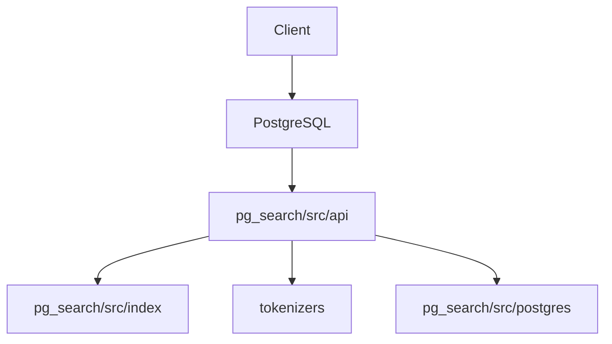

# paradedb/paradedb

> Extension Postgres pour recherche plein texte, vectorielle et analytique dans une seule base.

## Le problème
Combiner base applicative, moteur de recherche et analytique impose plusieurs systèmes à synchroniser.

## Ce que ça fait vraiment
Extension Postgres (`pg_search`) en Rust qui ajoute un index BM25 pour recherche plein texte, recherche vectorielle et hybride, filtres, facettes, agrégats et jointures. S'appuie sur pgrx, Tantivy et Apache DataFusion, en SQL standard avec transactions ACID. Intégrations ORM (Django, SQLAlchemy, Rails...) et agents (MCP, Agent Skills).

## Comment c'est branché


## Essayer
```bash
curl -fsSL https://paradedb.com/install.sh | sh
```

## Coût et pièges
Gratuit en auto-hébergé ; ParadeDB Cloud existe en version gérée. Licence AGPL-3.0 : obligations si tu proposes le service à des tiers.

## Ce que ce n'est pas
Pas un remplaçant clés en main d'Elasticsearch à grande échelle sans test. Le script `curl | sh` demande de la confiance.

## Alternatives
Aucune alternative nommée dans le README.

## Pour toi
Surveiller : très pertinent pour du RAG hybride sur Postgres, mais l'AGPL impose de vérifier l'usage avant adoption.

