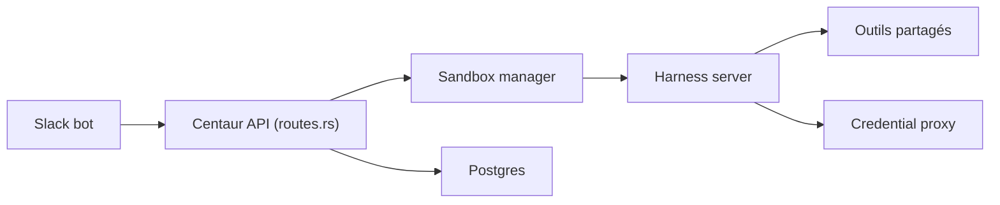

# paradigmxyz/centaur

> Self-hosted platform of shared agents for a team, driven from Slack with a Kubernetes sandbox.

## The problem
Everyone hacks together their own agent locally, with no shared tools or traceability, and hands their API keys to the agent.

## What it actually does
A keyword in Slack (or the API) triggers a conversation run in an isolated Kubernetes sandbox, with shell, git, Python, Node. Choice of harness (Amp, Claude Code, Codex). Shared Python tools, durable workflows (sleep, resume, child agents), state stored in Postgres. An outbound proxy, iron-proxy, injects credentials: the sandbox only sees dummy values.

## How it is wired


## Trying it
```bash
brew install just
just bootstrap-secrets
just up
```

## Cost and gotchas
Secrets required (1Password, Slack, signing keys). Kubernetes (k3s is enough locally). Harness costs are on you. The README mentions a local extraction path specific to the author. 108 open issues.

## What it is not
Not a turnkey product: installation is heavy and the licence is not identified. The README lists known limitations, including a shared credential vault.

## Alternatives
No alternative named in the README.

## For you
Worth watching: an interesting isolation and credential-management architecture for team agents, but young, heavy and without a clear licence.
