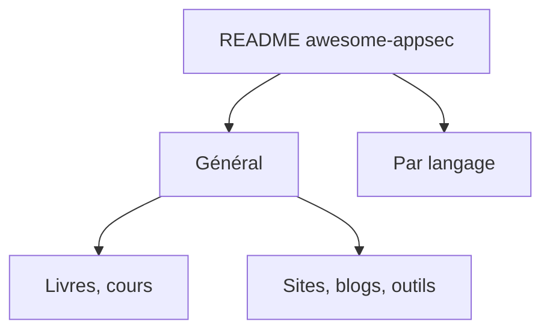

# paragonie/awesome-appsec

> Annotated list of books, sites, blogs and quizzes for learning application security.

## The problem
Starting out in application security without landmarks leads to bad practices, for example in crypto or password storage.

## What it actually does
Categorized list: general articles, books, courses, practice sites (Juice Shop, NodeGoat, PentesterLab), blogs, tools (Qualys SSL Labs, securityheaders.io), then per-language sections (PHP, Python, Java, C, Go, Node.js, etc.). Each entry carries a short description and often a date. Many resources date from 2009 to 2018.

## How it is wired
Simplified diagram based on the sheet, no diagram provided.

## Trying it
No command: it is a list to read.

## Cost and gotchas
Free. Content partly old, last push on 2025-02-22. Several links lead to paid books. The offensive books and sites (Hack This Site, Violent Python) are only references.

## What it is not
Not a tool nor a compliance checklist. Nothing on the security of AI models or MLOps pipelines.

## Alternatives
No alternative named in the README, apart from the resources in the list.

## For you
Ignore: mostly oriented toward web development and crypto, often dated, of little use to a data / AI / MLOps profile.
