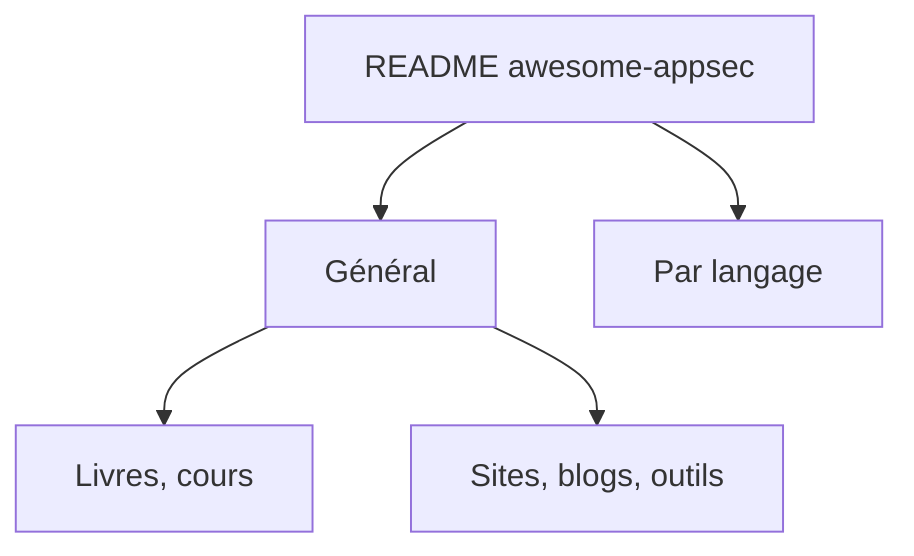

# paragonie/awesome-appsec

> Liste commentée de livres, sites, blogs et quiz pour apprendre la sécurité applicative.

## Le problème
Débuter en sécurité applicative sans repères mène à de mauvaises pratiques, par exemple en crypto ou en stockage de mots de passe.

## Ce que ça fait vraiment
Liste classée : articles généraux, livres, cours, sites d'entraînement (Juice Shop, NodeGoat, PentesterLab), blogs, outils (Qualys SSL Labs, securityheaders.io), puis des sections par langage (PHP, Python, Java, C, Go, Node.js, etc.). Chaque entrée porte une courte description et souvent une date. Beaucoup de ressources datent de 2009 à 2018.

## Comment c'est branché
Schéma simplifié d'après la fiche, sans diagramme fourni.

## Essayer
Aucune commande : c'est une liste à lire.

## Coût et pièges
Gratuit. Contenu en partie ancien, dernier push le 2025-02-22. Plusieurs liens mènent à des livres payants. Les livres et sites offensifs (Hack This Site, Violent Python) ne sont que des références.

## Ce que ce n'est pas
Pas un outil ni une checklist de conformité. Rien sur la sécurité des modèles d'IA ou des pipelines MLOps.

## Alternatives
Aucune alternative nommée dans le README, hors les ressources de la liste.

## Pour toi
À ignorer : surtout orientée développement web et crypto, souvent datée, peu utile à un profil data / IA / MLOps.

