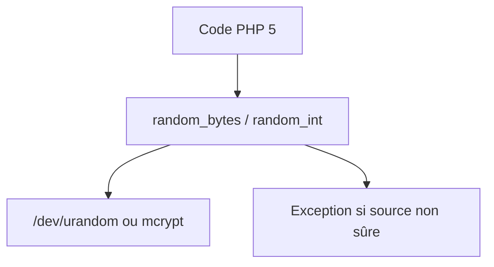

# paragonie/random_compat

> PHP 5 polyfill for the random_bytes() and random_int() functions, for legacy PHP projects.

## The problem
PHP 5 has no native cryptographic random generator, which PHP 7 provides.

## What it actually does
The library exposes `random_bytes()` and `random_int()` as in PHP 7. If the OS cannot produce secure random data, it throws an exception and never falls back to a weak generator. A special version 9.99.99 does nothing and only installs under PHP 7.

## How it is wired
Simplified diagram based on the sheet, no diagram provided.


## Trying it
```bash
# Le README annonce "With Composer" sans donner la commande.
# Exemple d'usage cité : $string = random_bytes(32);  et  $int = random_int(0, 255);
```

## Cost and gotchas
Free. Use a stable version, not the master branch. Version conflicts (~1.1 versus 2) are resolved in composer.json. Real requirement: PHP, which is missing from the prerequisites list.

## What it is not
Not a pseudo-random generator for simulation or ML. The README states that it may have escaped implementation errors.

## Alternatives
No alternative named in the README.

## For you
Ignore: PHP 5 polyfill for legacy code, unrelated to data/AI work.
