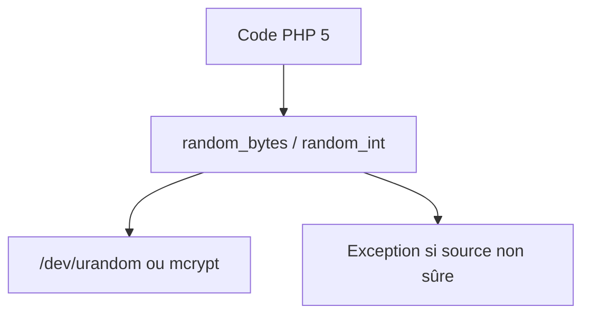

# paragonie/random_compat

> Polyfill PHP 5 des fonctions random_bytes() et random_int(), pour projets PHP anciens.

## Le problème
PHP 5 n'a pas de générateur aléatoire cryptographique natif, que PHP 7 fournit.

## Ce que ça fait vraiment
La bibliothèque expose `random_bytes()` et `random_int()` comme en PHP 7. Si l'OS ne peut pas produire de données aléatoires sûres, elle lève une exception et ne retombe jamais sur un générateur faible. Une version spéciale 9.99.99 ne fait rien et ne s'installe que sous PHP 7.

## Comment c'est branché
Schéma simplifié d'après la fiche, sans diagramme fourni.


## Essayer
```bash
# Le README annonce "With Composer" sans donner la commande.
# Exemple d'usage cité : $string = random_bytes(32);  et  $int = random_int(0, 255);
```

## Coût et pièges
Gratuit. Utiliser une version stable, pas la branche master. Les conflits de version (~1.1 contre 2) se règlent dans composer.json. Besoin réel : PHP, absent de la liste des prérequis.

## Ce que ce n'est pas
Ce n'est pas un générateur pseudo-aléatoire pour la simulation ou le ML. Le README précise qu'il peut avoir échappé à des erreurs d'implémentation.

## Alternatives
Aucune alternative nommée dans le README.

## Pour toi
À ignorer : polyfill PHP 5 pour du code hérité, sans rapport avec un travail data/IA.

