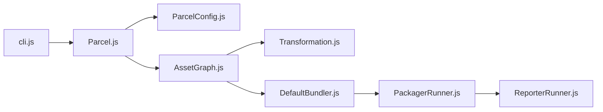

# parcel-bundler/parcel

> Zero-configuration web build tool that bundles and optimizes assets, for front-end developers.

## The problem
Configuring a bundler by hand before writing the first line of code.

## What it actually does
The README contains only a link (./packages/core/parcel/README.md): no information of its own. According to the architecture: entries and options, dependency resolution, transformations, bundles, packaging, optimization, then reports or a development server. Plugins are chosen in the configuration.

## How it is wired

## Trying it
No command documented in this README.

## Cost and gotchas
Nothing documented.

## What it is not
README empty of content: from this text alone, we know neither how to install it nor what it handles.

## Alternatives
No alternative named in the README.

## For you
Watch: a front-end tool with no direct link to data or AI; the material is too thin to decide.
