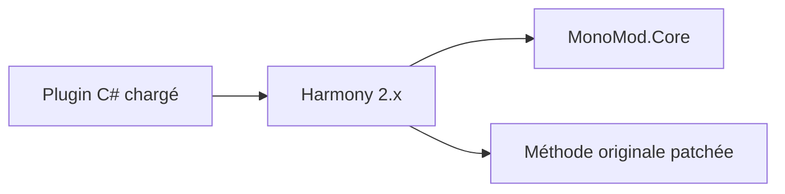

# pardeike/Harmony

> A library that modifies .NET and Mono methods at runtime, for C# mod makers.

## The problem
Changing the behavior of an already compiled C# application, without touching its files, is difficult.

## What it actually does
It replaces or decorates methods at runtime: keep the original intact, run code before or after, transform IL, with several patches coexisting. It is used in games (Rimworld, Stardew Valley, Subnautica) and to test WPF controls. This branch maintains Harmony 2.x.

## How it is wired
Simplified diagram based on the sheet, no diagram supplied.

## Trying it
The README contains no command: it recommends the `Lib.Harmony` NuGet package (or `Lib.Harmony.Thin`) and points to the documentation.

## Cost and gotchas
Free. Harmony 1 and 2 are incompatible. A single maintainer, who asks for donations.

## What it is not
Not a general instrumentation tool: it targets .NET and Mono. Not an intrusion tool described as such in the README.

## Alternatives
No alternative named in the README.

## For you
Ignore: useful for .NET game modding, unrelated to a data, AI or MLOps profile.
