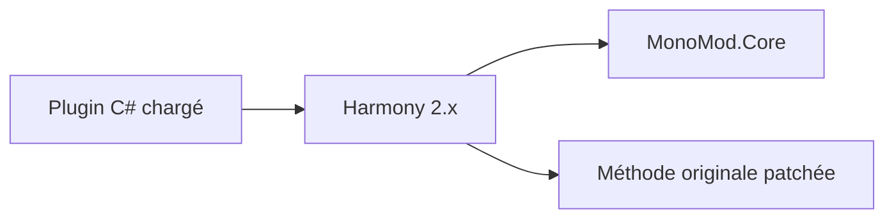

# pardeike/Harmony

> Une bibliothèque qui modifie des méthodes .NET et Mono à l'exécution, pour les créateurs de mods en C#.

## Le problème
Modifier le comportement d'une application C# déjà compilée, sans toucher ses fichiers, est difficile.

## Ce que ça fait vraiment
Elle remplace ou décore des méthodes à l'exécution : garder l'original intact, exécuter du code avant ou après, transformer l'IL, avec plusieurs patchs qui cohabitent. Elle est utilisée dans des jeux (Rimworld, Stardew Valley, Subnautica) et pour tester des contrôles WPF. Cette branche maintient Harmony 2.x.

## Comment c'est branché
Schéma simplifié d'après la fiche, sans diagramme fourni.

## Essayer
Le README ne contient pas de commande : il recommande le paquet NuGet `Lib.Harmony` (ou `Lib.Harmony.Thin`) et renvoie à la documentation.

## Coût et pièges
Gratuit. Harmony 1 et 2 sont incompatibles. Un seul mainteneur, qui demande des dons.

## Ce que ce n'est pas
Pas un outil général d'instrumentation : il cible .NET et Mono. Pas un outil d'intrusion décrit comme tel dans le README.

## Alternatives
Aucune alternative nommée dans le README.

## Pour toi
À ignorer : utile en modding de jeux .NET, sans lien avec un profil data, IA ou MLOps.

