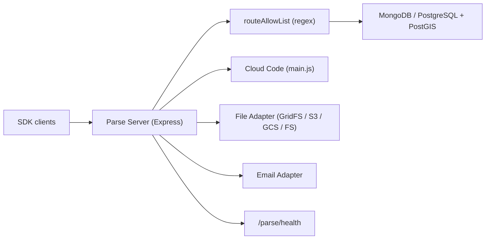

# parse-community/parse-server

> Open-source Node.js application backend, deployable anywhere Express runs.

## The problem
A mobile or web application needs objects, users, sessions, files, push
and server code: rewriting everything for each project costs weeks.

## What it actually does
An Express server that exposes a REST and GraphQL API on MongoDB or PostgreSQL+PostGIS. Four
hierarchical access scopes (`maintenanceKey`, `masterKey`, `readOnlyMasterKey`, `sessionToken`).
A `routeAllowList` of anchored regex patterns restricts the REST routes reachable from outside, without
affecting Cloud Code's internal calls. Password and account-lockout policy,
email verification and reset via adapters, custom routes and pages, file
adapters (GridFS by default, S3, GCS, filesystem), and a `/parse/health` endpoint.

## How it is wired


## Trying it
```bash
npm install -g parse-server mongodb-runner
mongodb-runner start
parse-server --appId APPLICATION_ID --masterKey MASTER_KEY --databaseURI mongodb://localhost/test
docker build --tag parse-server .
```

## Cost and gotchas
The compatibility schedule is strict and dated: Node.js 20 up to the 9.x releases, MongoDB 7 up to the 9.x releases,
PostgreSQL dropped about two years before its official end of life. `fileUpload.allowedFileUrlDomains`
is `['*']` by default, which leaves the door open to an SSRF via a crafted file URL.
Idempotency enforcement is flagged as experimental and possibly unsuitable for production.

## What it is not
Not a hosted service: it is a module you deploy yourself. `routeAllowList` covers neither file
routes, nor GraphQL (a single route for all operations), nor the Pages API, which must
remain reachable without credentials. The README is truncated in the middle of the idempotency section.

## Alternatives
- `parse-server-api-mail-adapter`: the official email adapter maintained by Parse Platform.
- The community adapters (Postmark, SendGrid, Mailgun…) named in the README.

## For you
Unrelated to data or MLOps: rule it out, unless taking over an existing Parse application.
