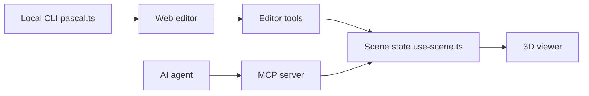

# pascalorg/editor

> Local 3D building editor (React Three Fiber, WebGPU) that AI agents can drive via MCP.

## The problem
Modeling a building in 3D and having an agent manipulate it requires heavy, closed tools.

## What it actually does
A web editor (Next.js) and a CLI that launches the editor and an authenticated MCP service, with projects in local SQLite. A node-based scene (site, building, level, wall, slab, zone, objects) managed by Zustand, with undo and systems that regenerate geometry. Reusable npm packages (core, viewer, editor, nodes), Docker image, agent skills (`pascal-3d`, `furniture-fit`), IFC export and a plugin system.

## How it is wired


## Trying it
```bash
npx @pascal-app/cli editor
docker run -d -p 3000:3000 -v pascal-data:/data -e PASCAL_ADMIN_PASSWORD=change-me -e PASCAL_PUBLIC_URL=https://pascal.example.com ghcr.io/pascalorg/pascal-editor:latest
npx skills add pascalorg/editor --skill pascal-3d --skill furniture-fit
```

## Cost and gotchas
Free locally (Node ≥ 22.13). Only one active agent client per local service. The "Pascal Next" demo is not in the open-source version. The hosted server requires an optional key.

## What it is not
Not a full CAD or BIM tool: the README does not claim that. The features of the "Next" preview are not available here.

## Alternatives
No alternative named in the README.

## For you
Ignore for a data / AI / MLOps profile: the domain (3D buildings) is outside your uses; only the MCP angle for driving a scene might serve as a reference.
