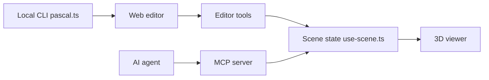

# pascalorg/editor

> Éditeur 3D de bâtiments local (React Three Fiber, WebGPU) pilotable par agents IA via MCP.

## Le problème
Modéliser un bâtiment en 3D et le faire manipuler par un agent demande des outils lourds et fermés.

## Ce que ça fait vraiment
Éditeur web (Next.js) et CLI qui lance l'éditeur et un service MCP authentifié, avec projets en SQLite local. Scène en nœuds (site, bâtiment, niveau, mur, dalle, zone, objets) gérée par Zustand, avec annulation et systèmes qui régénèrent la géométrie. Paquets npm réutilisables (core, viewer, editor, nodes), image Docker, skills d'agent (`pascal-3d`, `furniture-fit`), export IFC et système de plugins.

## Comment c'est branché


## Essayer
```bash
npx @pascal-app/cli editor
docker run -d -p 3000:3000 -v pascal-data:/data -e PASCAL_ADMIN_PASSWORD=change-me -e PASCAL_PUBLIC_URL=https://pascal.example.com ghcr.io/pascalorg/pascal-editor:latest
npx skills add pascalorg/editor --skill pascal-3d --skill furniture-fit
```

## Coût et pièges
Gratuit en local (Node ≥ 22.13). Un seul client agent actif par service local. La démo « Pascal Next » n'est pas dans la version open source. Le serveur hébergé demande une clé optionnelle.

## Ce que ce n'est pas
Pas un outil de CAO ni de BIM complet : le README ne revendique pas cela. Les fonctions de l'aperçu « Next » ne sont pas disponibles ici.

## Alternatives
Aucune alternative nommée dans le README.

## Pour toi
À ignorer pour un profil data / IA / MLOps : le domaine (bâtiment 3D) est hors de tes usages ; seul l'angle MCP pour piloter une scène pourrait servir de référence.

