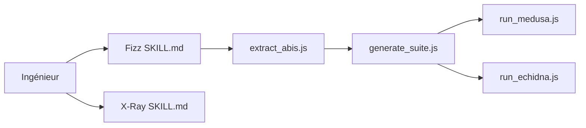

# pashov/skills

> Three AI agent skills for auditing Solidity contracts: x-ray, solidity-auditor and fizz.

## The problem
Auditing a Solidity contract requires long, repetitive preparation, review and fuzzing work.

## What it actually does
Very short README. Three independent skills: `x-ray` (pre-audit scan: threat model, invariants, entry points, git analysis), `solidity-auditor` (agent-based review) and `fizz` (Echidna/Medusa fuzzing suite for Foundry or Hardhat). The fizz code extracts ABIs, generates the suite and runs the fuzzers.

## How it is wired


## Trying it
```
Install https://github.com/pashov/skills/ and run an x-ray on the codebase
run fizz on the codebase
update skills to latest version
```
To give to your AI agent.

## Cost and gotchas
Agent calls are at your expense. The README gives no details on the prerequisites of the fuzzing tools.

## What it is not
Not a substitute for a human audit, whatever "hundreds of Critical/High vulnerabilities found" suggests (a README claim, not verified here).

## Alternatives
No alternative cited in the README.

## For you
Ignore: specialized Solidity domain, unrelated to data, AI or MLOps, and too little documentation.
