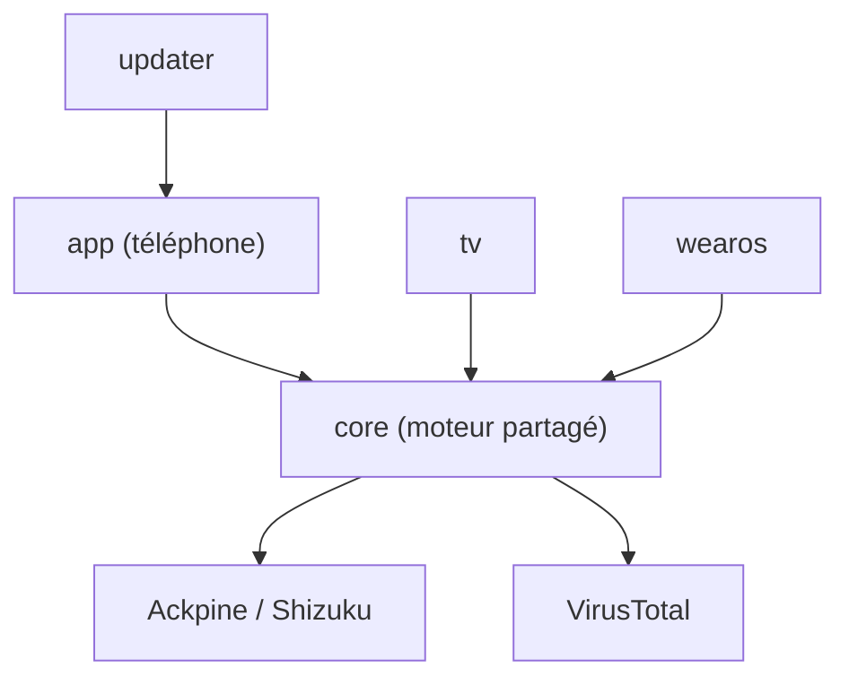

# pass-with-high-score/universal-installer

> APK installer for Android, phone, TV and watch, with XAPK, OBB and silent installation.

## The problem
Installing APK, XAPK or APKM packages with OBB files on Android takes several manual steps.

## What it actually does
It installs through the system, Shizuku or root, silently, with privileged options (downgrade, permissions, installer-name spoofing). It extracts OBB files, queries VirusTotal by hash before installation, shares APKs through a local HTTP server and a push to Android TV, manages installed applications and downloads from a URL.

## How it is wired
Simplified diagram based on the sheet, no diagram provided.



## Trying it
```bash
./gradlew :app:assembleOpensourceDebug
./gradlew :tv:assembleDebug
./gradlew :wearos:assembleDebug
```

## Cost and gotchas
Free. Java or Kotlin, Android Studio, JDK 17+ and SDK 36 to build. The VirusTotal scan depends on a third-party service. The "play" variant requires a google-services.json file.

## What it is not
Not an app store: it hosts no packages.

## Alternatives
No alternative named in the README.

## For you
Ignore: an Android utility, unrelated to your data / AI work.
