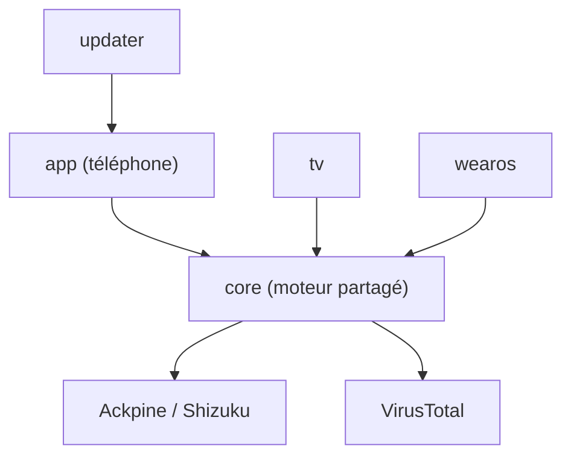

# pass-with-high-score/universal-installer

> Installateur d'APK pour Android, téléphone, TV et montre, avec XAPK, OBB et installation silencieuse.

## Le problème
Installer des paquets APK, XAPK ou APKM avec fichiers OBB sur Android demande plusieurs manipulations.

## Ce que ça fait vraiment
Il installe via le système, Shizuku ou root, en silence, avec options privilégiées (rétrogradation, permissions, usurpation du nom de l'installateur). Il extrait les OBB, interroge VirusTotal par hash avant installation, partage des APK par un serveur HTTP local et un envoi vers Android TV, gère les applications installées et télécharge depuis une URL.

## Comment c'est branché
Schéma simplifié d'après la fiche, sans diagramme fourni.



## Essayer
```bash
./gradlew :app:assembleOpensourceDebug
./gradlew :tv:assembleDebug
./gradlew :wearos:assembleDebug
```

## Coût et pièges
Gratuit. Java ou Kotlin, Android Studio, JDK 17+ et SDK 36 pour compiler. L'analyse VirusTotal dépend d'un service tiers. La variante « play » exige un fichier google-services.json.

## Ce que ce n'est pas
Ce n'est pas un magasin d'applications : il n'héberge aucun paquet.

## Alternatives
Aucune alternative nommée dans le README.

## Pour toi
À ignorer : utilitaire Android, sans lien avec ton métier data / IA.

