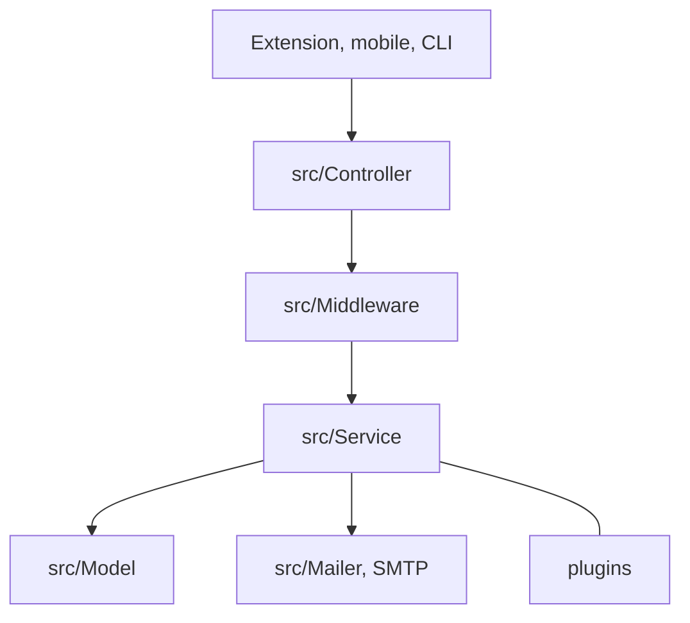

# passbolt/passbolt_api

> Open source password manager for teams, with end-to-end encryption, to self-host.

## The problem
Teams exchange passwords and secrets through chat or spreadsheets, with no permissions or traceability.

## What it actually does
PHP API server (CakePHP conventions) that centralizes and shares credentials and secrets between users and groups. Keys belong to users (GPG/OpenPGP), with JWT and multi-factor authentication as plugins. Clients are browser extensions, mobile apps and a third-party CLI. The README claims there is no telemetry or collection of personal data.

## How it is wired


## Trying it
```bash
# Aucune commande dans le README : l'installation passe par les guides en ligne
# (docker, kubernetes, Ubuntu, Debian, etc.) liés depuis passbolt.com/ce
```

## Cost and gotchas
Free in the community edition, but you need a server, a database and an SMTP server at your own expense. Lost user keys complicate recovery.

## What it is not
Not an app for direct use: the API alone is not enough, you need a browser extension or a client app. The desktop app is announced as "coming soon" (pre-alpha). AGPL license: check before any modified commercial use.

## Alternatives
No alternative named in the README.

## For you
Keep an eye on it: useful if your team wants to host its secrets (API keys, cloud access) without SaaS, with no direct link to data work.
